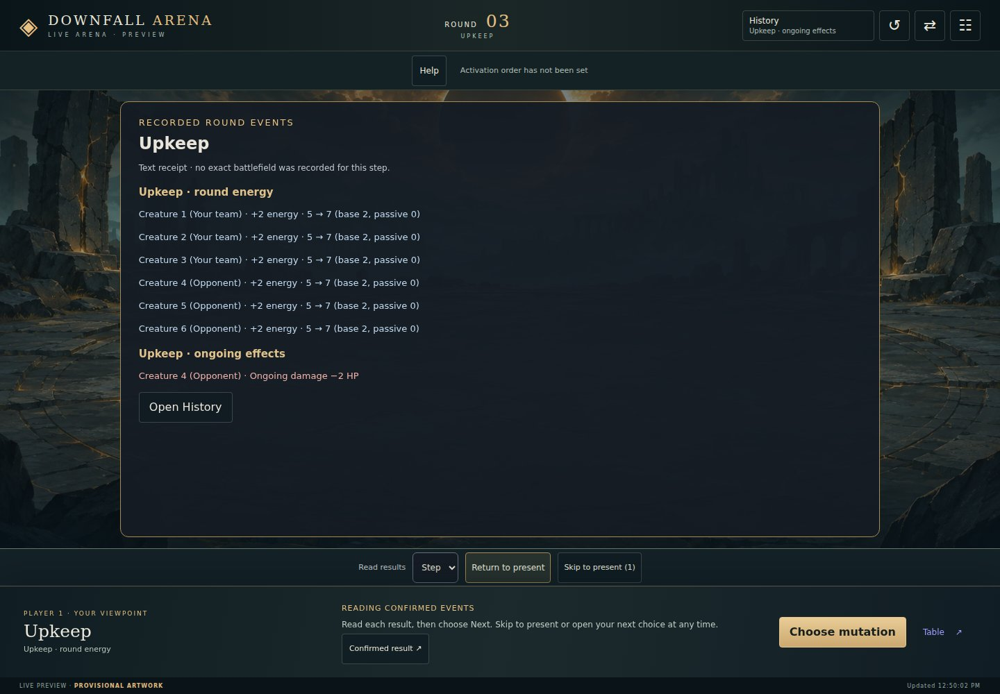
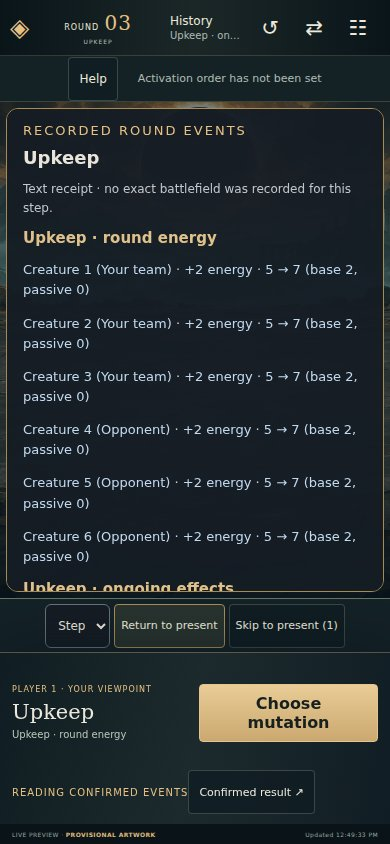

# Phaser battle presentations

Two Phaser pages: a viewport-bound visual experiment at `/battle-lab`, isolated from the actual `/play` client,
and `/battle`, the opt-in complete game loop for one authenticated seat (ADRs 0125–0128).
Pinned Phaser 4.2.1 + TypeScript, bundled locally with esbuild. [ADR 0123](../docs/adr/0123-prototype-the-arena-as-an-isolated-presentation.md)
records the choice; the [delivery plan](../docs/tabletop/browser-battle-plan.md) covers live integration.

## Build and run

From the repository root (Node 22 and .NET 10):

```bash
npm --prefix battle ci --ignore-scripts
npm --prefix battle run build
dotnet run --project src/DownfallArena.Cli -- table --lobby
```

Open the printed host URL at `/battle-lab`. For a static preview after building:
`python3 -m http.server 8765`, then `/table/battle-lab.html` on that server.
Rebuild after changing TypeScript or the imported shared table modules; there is no watch server.

`build` type-checks and emits `table/battle-build/game.js` and `live.js`, legal comments and the Phaser MIT license.
Output is ignored, never committed. CI builds before route/browser tests. Docker uses a Node builder
stage and copies only the bundle/notices into the .NET runtime alongside the local WebP assets.
No CDN, remote fonts or browser package downloads are needed at runtime.

## Boundaries

- `src/main.ts`: accessible DOM controller, input, dialogs, lifecycle and optional synthesized sound.
- `src/scene.ts`: Phaser scene, local assets, creature figures, cancellable tweens and camera effects.
- `src/types.ts`: presentation types only.
- `src/spell-effects.ts`: bounded, cancellable vector motifs for confirmed spell outcomes.
- `data/presentation/spell-art.json`: each spell's visual family, motif and delivery, published by the builder
  and served on the card; `table/battle-playback.js` reads it off the card, with neutral and fizzle fallbacks.
- `table/battle-art.js`: audited sprite manifest, the body and accents a creature's acquired packages give it (read off the
  catalogue's packages, authored in `data/presentation/mutation-art.json`), and mirrored geometry.
- `table/battle-lab-state.js`: the deterministic sample state machine, which carries the one action it offers,
  and the cancellation generation.
- `table/battle-layout.js`: the portrait/landscape geometry, shared by the Phaser figures and the HTML hit
  targets so the two cannot drift.
- `table/battle-lab-fixture.js`: fictional before/after frames. Never import this into a live adapter.

The `table/` modules are plain JavaScript so `node --test table/*.test.js` covers them without a build:
the TypeScript imports them and owns Phaser and DOM integration.

No rules, legality, damage or random resolution are reimplemented here. `/battle-lab` keeps its fixture
and makes no API requests. `/battle` is the opt-in live entry point: choose an accepted seat, inspect its
board, and complete planning, combat, review and replay. `/play` remains the classic alternative. It shares [`table/presentation.js`](../table/presentation.js)
with the table. [ADR 0125](../docs/adr/0125-read-one-authenticated-seat-in-the-live-arena.md) describes
seat discovery, explicit viewpoints, read-only transport, arrival behavior and recovery.

- `src/live.ts`: live DOM adapter and lifecycle; no lab imports.
- `table/battle-live.js`: snapshot adapter and fenced polling/SSE connection.
- `table/battle-playback.js`: bounded confirmed-action queue; pure historical frames, motifs and cancellation.
- `table/battle-history.js`: public recent-event journal, independent of playback; `src/history.ts` renders its accessible drawer.
- `table/battle-seats.js`: read-only capability discovery and return links.
- `table/battle-layout.js`: shared geometry for 1v1, 2v2 and 3v3.

Opening combat controls acknowledges the visible asking. Explicit confirmation sends Action, Intent or
Target through the existing transport; inspection alone remains read-only. `table/battle-combat.js`
fences drafts and pending commands, while `src/combat.ts` draws their accessible controls.
[ADR 0126](../docs/adr/0126-answer-combat-questions-in-the-live-arena.md) records this extension.
Invitation acceptance stays at `/play`.
401/403 clears private content; a transient failure labels the last snapshot stale. A hidden page
stops and clears its display, then reconnects from a new snapshot. The host's existing reads mark an
accepted seat as arrived, which may start a waiting match.
The live bundle measured 1,556,136 bytes uncompressed in AU14 (425,910 with local gzip). Four creature WebPs total 1,212,726 bytes,
plus the eclipse background; the old three-frame sheet is no longer loaded. Device performance and transfer compression remain to be measured before release.
The build enforces raw/gzip bundle and initial-art budgets (A8); transfer compression and physical-device
performance still require release measurement.

## Verify

```bash
node --test studio/*.test.js table/*.test.js
npm --prefix studio/browser ci --ignore-scripts
npm --prefix studio/browser exec -- playwright install chromium
npm --prefix studio/browser test -- battle-lab.spec.js battle-live.spec.js battle-combat.spec.js battle-playback.spec.js battle-loop.spec.js battle-history.spec.js battle-guidance.spec.js battle-upkeep.spec.js battle-spellbook.spec.js battle-mutations.spec.js battle-tempo.spec.js battle-pacing.spec.js battle-growth.spec.js battle-order.spec.js battle-targets.spec.js battle-inspection.spec.js battle-services.spec.js battle-parity.spec.js
dotnet build
dotnet test --no-build
dotnet format --verify-no-changes
```

The browser suite checks actual Phaser startup, both orientations, 320px width, 44px target bounds,
no document scrolling, rotation, all three outcomes, cancellation/reset, keyboard/skip, reduced motion,
2× settings, missing-art fallback and no API requests. Route tests verify WebP binary handling and the
packaged bundle. Screenshots in the delivery plan come from the actual .NET host.

The lab remains one authored action. The live scene plays the host's confirmed before/after frames in
sequence, including damage, recovery, energy, conditions, fizzles and defeat. Skip, opening combat controls,
resize and connection interruption return immediately to the current snapshot. First loads and hidden-tab
returns never replay history. Legacy events, and one read bringing more than twelve actions, use confirmed
text on the latest board. Result details remain available in an accessible overlay. Both pages use four audited forms with uniform scaling and explicit ground anchors ([ART-3](../docs/art/runtime-sprites.md)). Real-device Safari,
Android GPU/performance, screen readers and high zoom remain future acceptance.

A7 completes planning and the match result in the scene shell ([ADR 0128](../docs/adr/0128-complete-the-game-loop-in-the-arena.md)).
`table/battle-planning.js` fences mutation, tempo and tie drafts; `src/planning.ts` renders the private mutation tree
with explicit confirmation and a separate read-only reference (AU4). AU5 adds editable team tempo tabs and one
confirmation over the host's sequential questions, with simultaneous reveal still owned by the host (ADR 0135).
`table/battle-match.js` and `src/match.ts` provide two-round upkeep/aftermath review,
concession, the host outcome and a manual whole-match replay. Replay steps distinguish recorded action frames,
labelled reference frames and missing battlefield snapshots. `/battle?replay=<session>&seat=player2` opens a
finished recording using the same operator authorization as `/play?replay=...`.

`node node_modules/playwright/cli.js test --config table.config.js battle.loop.js` (from `studio/browser`)
plays complete 3v3 games in both declarations, reads recorded sessions, and checks two independent seats'
simultaneous choices and concession against the real .NET engine.

## AU1: recent match history

The **History** button previews the latest public event and opens a chronological journal of the current
and previous round (up to 200 events). Expand an attack to read its caster, spell, targets, critical/fizzle,
applied effects, dropped targets and recorded before/after values. Upkeep ticks, public mutation reveals,
intent reveals, the turn order with each slot's tempo, skipped turns, aftermath and the outcome share the
same list; a round or phase beginning is a marker read in place. Creatures are named the way the scene names
them (the id only tells namesakes apart) and the outcome is read for this seat, although the feed names slots
the way the engine does. Unknown event payloads and unrevealed choices are never rendered; a generic notice
identifies unsupported event types. Missing action frames are labelled rather than inferred from the current board.

History is available from the header, planning/combat choices and action result. Opening it settles
playback without sending a decision or acknowledging a question. Command drafts and focus return on close;
expanded entries and reading position survive polling. New events follow the bottom only when the reader
is already there; otherwise **Latest** announces their count. First loads populate history without replaying
animations. Switching viewpoint, hidden tabs, lost access and renderer failure clear every journal surface.

This implements AU1 of the [UX parity plan](../docs/tabletop/battle-ux-parity-plan.md).
Automatic upkeep is presented by AU3b below; AU6 adds older-round loading, filtering and
recorded-event inspection below. The existing upkeep review remains available. This slice adds no domain
rules, transport contract or storage. Browser tests cover 320px portrait and short landscape, focus/drafts,
read-only access, deduplication, scroll retention and clearing on access loss. The real-host complete-match
journeys compare journal action identities against actual seat responses in both declaration modes.

AU1 captures from the real .NET host (seed 7, 3v3, at-activation; provisional artwork):
[desktop history](../docs/tabletop/images/battle-history/desktop.jpg) ·
[phone history](../docs/tabletop/images/battle-history/phone.jpg).

[ART-4](../docs/art/spell-vfx.md) supplies 44 spell profiles for confirmed-action playback, with distinct
physical, biological, elemental, necromantic and astral shapes. It preserves queue timing and accessible
outcomes; reduced motion bypasses all VFX. The browser playback suite also boots the production scene
in an isolated test harness to verify actual vector objects and their cleanup.

## AU2: objectives and contextual help

The command bar names the current objective: shared mutation picks, the creature choosing its tempo,
a tied group, an on-turn spell, a hidden intent, or targets for an already revealed spell. Waiting rooms,
opponent turns, sent choices, lost connections and recorded playback have separate instructions.
The **Help** button opens the current explanation and a four-phase round guide. The next mutation
opportunity comes from `board.nextEvolutionRound`; the guide follows the catalogue's declaration mode, where
a stamp that names none plays hidden intents (ADR 0110), and names creatures the way the scene does.

Each instructional subject opens automatically once in each game, after playback and other dialogs have settled
([ADR 0142](../docs/adr/0142-teach-each-phase-once-per-game.md)). **Phase tips** in Game settings turns them on
or off for every new game; **Do not show phase tips in this game** mutes them for this game only (ADR 0140).
Help remains available from the timeline, planning/combat choices and settings. The subjects read are kept
per game, for the latest twenty games, under `downfall.arena.help.v1`; no seat, token, question or choice is persisted. Denied storage falls
back to the current page's memory. Opening Help preserves drafts, restores focus on close and never
acknowledges a question or sends a command. Access loss clears its text.

`table/battle-guidance.js` derives this read-only model; `src/guidance.ts` owns the native dialog.
The UI's pass label now says **Pass remaining picks**, matching the engine's existing whole-round pass.
The AU3b receipt precedes first-use tips; the mutation chooser is covered by AU4 below and team tempos by AU5.

`battle-guidance.spec.js` covers default-on first-use behavior, persistence, mute/reopen, pending commands,
waiting/access loss, playback boundaries, both declaration modes, short orientations and enlarged text.
`battle.loop.js` completes real-host matches in both modes with tips enabled. Other focused battle journeys
set an explicit returning-player preference so they continue exercising their original controls.

Real-host captures: [desktop help](../docs/tabletop/images/battle-guidance/desktop.jpg) ·
[phone help](../docs/tabletop/images/battle-guidance/phone.jpg).

ART-5 adds [mutation cues](../docs/art/mutation-cues.md): one dominant body selected from the displayed
acquired tiers, two branch slots and an owner-only capstone accent. `mutation-cues.ts` follows the figure
transform, retains static cues under reduced motion, and suppresses them if the requested sprite is missing.
The live suite checks all nine branch pairs and lifecycle behavior with the production scene.

ART-6 adds [playback polish](../docs/art/battle-polish.md): shared timings, live 0.5×/1×/1.5×/2× playback and
opt-in synthesized sound. `audio.ts` owns one short voice, cancels pending resumes, and is shared with the
lab. Reduced motion keeps a 650 ms readable result at every speed. The playback suite exercises the
production audio owner and instrumented browser audio alongside the renderer.

## AU3a: recorded ordinary energy

New matches include **Upkeep · round energy** in History, with each recipient's actual gain, before/after
energy and base/passive request amounts. Zero gains are visible. These facts are captured before ongoing
energy, healing and bleed; a creature killed afterward retains its earlier receipt. Journal reads remain
read-only and deduplicated. Old recordings and resumed legacy matches have no ordinary-energy receipt;
the UI does not invent one from the default allowance. See [ADR 0132](../docs/adr/0132-record-ordinary-round-energy-without-renumbering-old-tables.md).

## AU3b: automatic upkeep receipts

Once human arrivals clear, the battle view presents one grouped **Round 1 · Upkeep** receipt. Each observed
round transition gets the same receipt, after confirmed-action playback finishes and before a phase tip.
An open reference or command draft delays it; Continue and Escape only dismiss presentation. Reading it
never acknowledges an asking or submits a choice. A first visit to an advanced match does not replay old
round announcements; the next observed round does. Catch-up keeps the latest round, not a queue of old popups.

`table/battle-upkeep.js` combines only public ordinary-energy and ongoing-effect events by their own
round IDs. Ordinary gains show before/after energy and base/passive requests, including zero. Ongoing
energy, healing (including capped zero healing), then damage follow the engine's order. The receipt waits
for the ongoing event so it does not announce half an upkeep. Missing ordinary energy in a legacy feed
is explicitly unknown. Neither catalogue defaults nor current boards supply historical totals. No-tick
rounds still show their ordinary grants. Expired conditions are not reconstructed as current effects.

Creature links open the existing **current** inspection, including present condition durations; this is
labelled separately from the historical receipt. History and round review retain the facts after dismissal,
and replay uses the same tick extraction and wording, preserving zero results and legacy missing-data text.
AU7 still owns paced aftermath/upkeep choreography.

`src/upkeep.ts` renders a native modal with a scrollable body and reachable Continue button. Polls preserve
nodes and focus. Viewpoint changes, hidden tabs, access loss and renderer failure erase the receipt and
inspection. `sessionStorage` key `downfall.arena.upkeep.seen.v1` keeps at most 32 table/seat round high-water
marks, never tokens, questions, choices or event facts. These prevent duplicate announcements on reconnect
and reload in the same tab; blocked storage falls back to memory. A new browser tab can announce its first
round once. Marks record presentation, not a host acknowledgement.

`battle-upkeep.spec.js` covers arrivals, recorded amounts, zero healing, inspection, History, deferred drafts,
closing-action boundaries, legacy data, reconnect/reload, access loss, renderer interruption, 320px portrait,
short landscape and 200% text. Real-host journeys in both declaration modes read every new-round receipt
before answering and still verify that presentation sends no command or acknowledgement.

Captures: [real-host opening receipt, desktop](../docs/tabletop/images/battle-upkeep/desktop.jpg) ·
[phone receipt with non-default/passive/zero fixture values](../docs/tabletop/images/battle-upkeep/phone-fixture.jpg).

## AU6: filter and inspect match history

History filters by loaded round, involved creature (caster or recipient), team and event kind, using
public event fields rather than parsed narration. A filtered-empty result is distinct from no events,
a failed history request or the beginning of available history. The header counts unread public events;
Latest clears filters and returns to the recent window. Reading history never acknowledges a covered
live question or submits a decision.

**Inspect event** opens a separate read-only pane: caster/spell, targets/result, applied effects,
dropped targets and recorded changes. Previous/Next follows the filtered events; Before/After displays
sanitized creature stats and condition durations from that event's exact boundary snapshots. Missing
snapshots are explicitly unavailable, even when current creature stats exist. The live battlefield
underneath continues to update; the inspection stays on its selected event until the player navigates
or returns to Latest. Closing returns focus and preserves the command draft. This is manual journal
inspection; AU7 still owns playback pacing.

**Load earlier rounds** explicitly calls the existing selected-seat `history()` read from zero. Its
response only replaces the reading page: it cannot rewind the live cursor, board, options or playback.
Requests are single-flight and generation-fenced after close, Latest, viewpoint/access loss and hiding.
403/401 still clear the whole seat through the connection. No other seat or unrestricted trace is read.
Unknown and unrevealed planning payloads are excluded before normalization; nothing is persisted.

The live cache holds at most 200 events from the current/previous round; an open reading page holds at
most another 200. A selected event is pinned within that page's cap across rollover. Polls preserve
existing DOM nodes, disclosures, focus and scroll; older-page loading never auto-reads incoming events.
At most 200 list rows and one inspection are rendered. Very large rounds may span multiple pages;
filters describe the loaded page, not a whole-match server search.

Long-session measurement on this workspace: **10,000 action events / 100 rounds / six creatures**,
115 ms initial normalization, 64 ms earlier-page normalization. The serialized view model was
1,130,268 bytes (including repeated references serialized as `rows` and `all`; this is not a heap
measurement). Cache caps remain 200 + 200 regardless of session length. The existing full-history
response was **19,268,091 bytes** in this synthetic case: the UI cache is bounded, but transfer and JSON
parsing still scale with the entire feed. Pagination on the same seat-filtered endpoint is the measured
follow-up for sessions of this size; it must retain the examined-entry cursor semantics and privacy fence.

Validation includes late older reads after newer live events, reload, failed loading/retry, exhausted and
filtered-empty states, stale response cancellation, pinned exact values after rollover, loss of access,
200-row rendering, both declarations' final attacks, and the existing command/receipt/playback journeys.
Captures: [desktop, recorded-event fixture with live rollover](../docs/tabletop/images/battle-history-review/desktop.jpg) ·
[phone, final attack from the real host](../docs/tabletop/images/battle-history-review/phone.jpg).

## AU4: compare offered mutations

The mutation phase opens its private tree by itself once the board is clear: after the upkeep receipt, the
turn order and a first-use tip ([ADR 0138](../docs/adr/0138-open-the-mutation-tree-with-the-mutation-phase.md)).
A pick that leaves team picks keeps the tree open on the next creature with offers and its remaining picks;
the last pick or a pass closes it. Tap an eligible ally, or use **Mutation tree** after closing it, to reopen.
The graph docks below the scene on phones and beside it on wider screens. Expand gives it more
space. Each selectable node corresponds to an offer from the host. Acquired paths and connections
use catalogue prerequisites, including shared capstones. Unknown offers stay selectable by id.

Selecting a branch previews its initiative, spells, passives and possible later paths. Phaser previews
available art only for that creature in the private command. Public inspection and replay keep their
recorded forms. Confirm spends one team pick. Switching creatures clears the draft, and passing requires
explicit confirmation for all remaining team picks. The full tree remains available as a read-only
disclosure. AU8 also exposes a public reference outside this phase.

`table/battle-mutations.js` supplies the host-filtered offers. `src/mutation-tree.ts` draws the graph
and `src/mutation-scene.ts` projects the private preview. The existing planning controller still owns acknowledgement,
host legality checks and duplicate/stale-command protection. `battle-mutations.spec.js` covers
comparison, late offers, recipient changes, passive capstones, missing content, effective budgets,
poll stability, pending acknowledgement and small/landscape layouts. `battle.loop.js` exercises the
chooser in complete real-host matches, including two-seat private choices.

Original AU4 card layout: [desktop](../docs/tabletop/images/battle-mutations/desktop.jpg) ·
[phone](../docs/tabletop/images/battle-mutations/phone.jpg).

## AU5: team tempo drafts

**Team tempos** opens a tab for every remaining eligible creature. Choose Instinct or Precision for each,
return to edit any tab, then **Confirm tempos** once. The compact spell reference shows cost and Precision
critical chance; current-creature guidance and catalogue-only references are explicitly distinguished.
The footer stays reachable while the choices and references scroll.

`table/battle-tempo.js` owns the draft and frozen batch; `src/tempo.ts` owns the tabs and references. The first
acknowledged creature's timing includes the team's draft time. Each later asking is acknowledged before its
write. A refusal, uncertainty or interruption stops automatic progress; accepted choices remain visible and
continuation requires another explicit confirmation after a fresh seat read. Hidden pages, seat changes and
reloads discard local drafts. No opponent choices or public history are altered before the host reveal.

`battle-tempo.test.js` exercises protocol interleavings; `battle-tempo.spec.js` covers actual controls,
references, errors, keyboard navigation, mobile layout and screenshots. `battle.loop.js` verifies full games
in both declarations and opponent privacy across a partial batch, reload and completion on the real host.
See [ADR 0135](../docs/adr/0135-draft-team-tempos-before-sequential-confirmation.md).

## AU9: compact grouped spellbook

Combat choices group the current creature's known/offered spells by the served card type, with family
accents from the shared talent palette. Compact cards show cost (including zero), positive critical chance
and availability. Current question guidance supplies current chances and unavailable reasons when present;
catalogue-only chances are labelled. An offered hidden intent that lacks energy remains selectable with
its shortfall and possible fizzle. Card cost, colour and ownership never create or revoke host offers.

**Full details** switches the whole reference to complete names, targeting, target/caster effects and critical
notes, including unavailable cards. Unknown catalogue entries keep their raw identity and remain playable
when offered. Actor, round, phase, tempo and energy stay beside the scrollable list; the explicit declaration
footer stays outside it. In at-activation mode, selecting still opens field targeting and casting still needs
confirmation. Double-tapping a card never submits a spell.

`table/battle-spellbook.js` derives the reference; `src/spellbook.ts` owns keyed HTML rows. Availability polls
update existing nodes, preserving focus, scroll, details mode and card positions. The same asking retains
browsing when returning from field targets. A new asking, creature, seat, hidden page or access loss clears
the reference and its local state. Nothing is persisted. Group/type fallback never guesses from effect prose.

`battle-spellbook.spec.js` covers a late multiclass hand, long names, zero cost/no critical, unavailable and
unknown cards, energy plans, full details, stable geometry/focus/scroll through polls, changed creatures,
explicit confirmation, access loss and short portrait/landscape layouts. Existing combat and real-host
journeys continue exercising the same decision protocol. AU10 adds selected-target previews below.


## AU7: pace results and round turnover

Match settings (the gear in the header) select **Step** (default) or **Auto**; the choice
is independent of Help, reduced motion and animation speed. A new game starts from the player's **Game
settings** (under the player's name in the account menu, or in the main menu when signed out; kept with the
account when signed in, in the browser otherwise; Step, 1×, tips on by default), and the match settings change that game alone ([ADR 0140](../docs/adr/0140-keep-game-settings-with-the-account.md)).
**Skip all** is offered while two or more results remain, never while an incoming action waits for its OK
([ADR 0141](../docs/adr/0141-never-hold-the-player-s-own-cast.md)).
Every incoming action, in either pace, animates and then holds its exact applied frame until the player's
**OK** (**Next** while more follows); only then comes the next action, the turnover or the live board
([ADR 0139](../docs/adr/0139-confirm-every-action-before-the-next-choice.md)). The player's own casts
move on by themselves in either pace; Step holds the turnover receipts (aftermath, upkeep, result) for **Next**,
Auto plays them by itself. While results remain, the action, mutation and
result entries are withdrawn and nothing opens by itself. **Skip all**, rotation (an orientation change, not every resize), a motion/speed change or
connection loss immediately restores the authoritative board. Results that arrive while a dialog
covers the board queue behind a held item (an incoming action, or a receipt in Step); otherwise they settle rather than play unseen. While results are read the dock is one card, in the dock's own row so the field never resizes: whose action
it was (opponent's, the player's own, or a round summary, with how many more follow), what was cast, what came of
it, and **OK**/**Next** and **Skip all** beside it. These presentation controls never submit or
acknowledge a question. Selecting a live command still explicitly opens and acknowledges that command.

The same ordered queue now contains closing casts, meaningful condition expiry/immunity, ordinary energy,
ongoing effects and the match result. Adjacent energy/ongoing records for the same round share a receipt,
including when they arrive in separate responses. Empty cleanup is omitted; zero healing and zero energy
remain recorded facts. A missing ordinary-energy record is explicitly unknown. Round 1 retains its
arrival-gated introductory receipt.

Action frames supply their own round, phase, creatures, resources, known spells and timeline. Turnover
records do not contain an exact battlefield, so they read on a recorded one, never a later board
([ADR 0143](../docs/adr/0143-read-the-turnover-on-the-field.md)): an aftermath on its round's last action frame,
an upkeep on the board it arrived with while that board is still before combat. A plaque on each creature says
what ended or changed, and the reading card gives one line, opening the full receipt. Without such a board the
plaques stand by name alone. Only the match result covers the field with a text receipt. The journal and round notes retain all received facts.

Every effect on a creature is one chip (`table/effect-chips.js`, drawn by `chipElement`): the icon of what moved
and the amount, a drop for damage with a CRIT mark when critical, a heart for healing, a bolt for energy, a
condition's own icon for a condition applied, the same dimmed for one ending. Spell outcomes at impact, upkeep
ticks and aftermath ends all use it, above the creature and in the reading card, where they gather by the
creature they landed on. The engine's words stay in each chip, unseen, for screen readers and History.

Received sequence, presented sequence and the last explicit **Next** are separate. Auto/Skip do not claim
an item was explicitly read. A presented upkeep, or one the player passes over with Skip or by opening a live choice, suppresses the
duplicate automatic upkeep modal (the existing tab-local marker); a rotation, a motion/speed change, a lost
connection or a catch-up never showed it, so its upkeep modal still opens; receipts that arrive under an open draft/reference remain available
through the deferred upkeep notice. No receipt facts, frames or drafts are persisted. First reads/reconnects
baseline existing events. More than twelve new casts, more than two rounds in one response, or more than
sixty queued new items fall back to the latest board and summary; History remains the reading surface for
that backlog. An unframed legacy cast also falls back to confirmed text, without invented animation.
AU8 unlock receipts stay hidden during paced history; opening a live spell choice after Skip retains its new-spell badge.

`battle-pacing.spec.js` covers ordered closing actions, no future budget/spells, split receipts, Step/Auto,
Skip, current command access, match completion, rotation and revocation. Playback/upkeep unit tests cover
deduplication, late callbacks, zero/unknown energy, meaningful cleanup and bounded catch-up. Captures below
are recorded-event browser fixtures, not real-match screenshots.





## AU8: growth reference and new abilities

Help and creature inspection open a persistent **Mutation Tree** over the current draft. Inspection
selects its creature; the reference can switch between both rosters. It reuses AU4's authored
prerequisite forest, including every all-of/any-of edge, spell details, initiative and exact shared
passive wording. Acquired tiers determine family/stage progress and multiclass summaries. Only a
current host Evolution offer marks a mutation Available; the next opportunity is the host's
`nextEvolutionRound`, never a client schedule. Its inclusive current-round value says "this round",
not "next"; finished matches offer no further opportunity. Unknown content and schedule remain explicit.

The standalone reference shows current **public** ownership. Pending own picks remain Picked only
in AU4's private command tree; they never enter public progress or receipts. Opening, exploring or
closing either reference does not acknowledge or submit a question. Native disclosures, a labelled
creature select and fixed Close control work by keyboard and on small/short screens. Unchanged polls
preserve expanded nodes, focus and scroll. Closing restores the covering Help/inspection and draft. Disclosures are kept across polls of the same
creature, not carried to another one.

`table/battle-growth.js` observes only new `PurchasesRevealed` feed events. The reveal is read in three
depths. On the battlefield, `src/mutation-reveal.ts` stands a Phaser crest above each creature that
mutated: the mutation in its family's colour, the stage reached and its new spells. The crests stay while
the field is uncovered, below the floating receipt. That receipt is one dismissible line, "Mutations
revealed" with the count per side, and the status line under it speaks every reveal in full. **See**
opens the reveal sheet: one card per creature, grouped by side, with stage, initiative, new spells with
their cost and targets, and passives. Each card leads to its creature's path in the reference tree,
where the families it holds open first. During catch-up it retains the latest reveal; History retains all public events. Its first
read is always a baseline, including reload, visibility return and seat switch, so historical unlocks
never masquerade as new ones. No extra storage, request, engine rule or host acknowledgement is added.
Private submission events and board changes alone cannot create a receipt. Access loss clears all facts.

A new spell badge belongs to its own creature's first visible Action/Intent spell choice. Existing
spells taught again by another tier are excluded. Covered controls and target-only questions do not
consume badges; closing/reopening the same asking retains them, and the next asking clears them.
Enemy reveals contribute to the public receipt but never to the player's badges.

`battle-growth.test.js` tests projection, baseline/deduplication, unknown/passive content and badge
lifetime. `battle-growth.spec.js` tests privacy, draft preservation, in-flight acknowledgement fences,
reload/access loss, keyboard and responsive layouts. `battle.growth.js` buys a real host offer and
checks its public tree, exact catalogue spell names and read-only access on desktop and phone.


## AU10: current-question target estimates

The target dock keeps the creature/spell, legal count, change/cancel controls and explicit confirmation
fixed beside a keyboard-scrollable estimate. Only this asking's host guidance supplies cost, energy after
cost, plain/critical outcomes and caster effects. Selected legal targets with equal outcomes group together;
caster effects appear once. Zero critical chance at the selected tempo suppresses impossible critical rows.
Hidden intentions show the cost and explain that targeting happens at resolution; they never bind targets.

Missing guidance, missing target outcomes and targetless caster previews have explicit unavailable messages;
a host's explicit empty caster outcome reads "No effect on caster" instead.
A host refusal replaces hypothetical effects with its reason. Empty casts advertise no effects. Predictions
are labelled estimates before caps/stacking; recorded History remains authoritative for actual outcomes.
The preview does not veto or extend the host's offered commands. Legal, selected, unavailable and full
multi-target states have text/shape cues as well as colour, without automatic submission. A stun shows
only on the tag, so a stunned creature keeps "Stunned" behind its state's mark (`+ Stunned`); its spoken
label carries both the condition and the state, without the marks. AU7's pacing row hides while targets are
chosen: opening the choice settled playback and the host is waiting for this seat, so its height goes to the
estimate; the pacing preference stays in Settings.

`table/battle-targets.js` derives presentation from the combat controller; `src/target-preview.ts` updates
text without moving confirmation or stealing focus/scroll. New questions, page hiding and access loss clear
it. Tests cover host costs, zero critical, self/ally/enemy/multiple/no targets, missing data and refusal,
resource/target changes, privacy cleanup, explicit writes and short portrait/landscape with enlarged text.
Real-engine combat journeys verify the displayed cost against the seat response in both declaration modes.

## AU11: turn order and recorded dice

**Order** opens a read-only reference from the compact activation strip; **Inspect turn order** is also
available above a tie draft. It shows every host position, tempo band, initiative and recorded d20 chain,
with explicit team labels and Completed / Now / Upcoming states. Defeated and stunned creatures stay in
their slots with their status. Creature links open the existing inspection. The strip and reference use
the presented board, so recorded replay retains its own round, order, rolls and cursor. Opening the
reference during live action playback explicitly settles that queue, like History. Missing initiatives
or rolls remain unrecorded; no local sort, simulated die or current-stat fallback supplies them.

A newly observed public TimelineBuilt event queues one reveal. It waits for both teams' tie
ordering, action playback and open dialogs/drafts to finish, then reads on the field before the next first-use
tip ([ADR 0144](../docs/adr/0144-read-the-turn-order-on-the-field.md)): a numbered badge on each creature, gold
for Instinct and blue for Precision, and the dock's card with each team's tempos, whether a d20 broke a tie, and
**Continue**. The card opens the full order. Until Continue nothing else plays: an opponent's action that
arrives meanwhile waits, unplayed, then plays and holds for its OK.
Reading Order manually consumes that pending reveal. Initial load, reload/reconnect and recorded sessions
are baselines, not a new announcement; duplicate events do not repeat it. Advancing beyond the round or
losing the seat clears it. No reveal preference or private data is persisted. The History entries for
TimelineBuilt and TiesOrdered retain their respective exact positions, initiatives and rolls, so the
initial order cannot be mistaken for the final same-team choices.

Tie groups explain their fixed team positions, the chosen occupant of each, and intervening opponent
positions. Only offered group members can move; the existing planning controller still owns confirmation,
acknowledgement and write fencing. A same-team tie with no recorded dice does not claim to have rolled.
Open references retain the draft and focus and never acknowledge a covered question.

`table/battle-order.js` holds the pure projections and reveal watermark; `src/order.ts` renders stable
native controls. `battle-order.spec.js` covers private/unrevealed choices, interleaved and multiple ties,
repeat reveals, cursor/condition updates, focus/scroll, lost access and small/landscape/enlarged text.
Full real-host journeys check order/rolls against seat responses in both declarations and inspect a past
round during match replay. Captures in `docs/tabletop/images/battle-order/` identify their data source.

Captures from the recorded-roll browser fixture: [desktop](../docs/tabletop/images/battle-order/desktop-fixture.jpg) · [phone](../docs/tabletop/images/battle-order/phone-fixture.jpg).


## AU12: public creature inspection

Every ally and opponent, including defeated creatures and missing-art fallbacks, opens a reference with
stable scene/journal identity, current defense/initiative, conditions and named spell/caster sources.
Fresh conditions, permanent effects, remaining countdowns and immunity keep the shared board semantics.
Every caption, on every screen, carries a badge row under the full name: initiative, defense with a
shield when above zero, and one icon per kind of condition (`src/condition-icons.ts`). The icon comes
from the host's effect cue, the stat the effect moves and whether it is a loss, so the page names no
effect: a health loss is a drop, a gain a heart, defense a shield up or cracked, a stun a star. The
numbers and the engine's words are in each badge's title, the accessible label and the inspection; the
status tag above is placed from the caption's measured height. A new round seen live is announced by a
short banner at the top of the field that fades by itself.

Acquired mutations come only from `acquiredTiers`, independently of `knownSpells`. Each mutation shows its
Stage, authored tags, initiative bonus and exact passive wording, including shared capstones. Known spell
disclosures show cost, targeting, target/caster effects and catalogue critical details, with acquired sources
where recorded. A known spell never marks a mutation acquired or reveals an intention. Missing catalogue
entries keep their identifiers and explicitly unavailable detail. Aggregate passive badges reuse `board.js`.

**Read action in History** opens the exact last public cast made by that creature, including fizzles and
recorded Before/After boundaries. The journal retains at most one additional normalized cast per current
roster creature beyond its existing 200-row live/reading windows; rollover therefore keeps the link.
Historical references label their latest loaded cast and filter by the displayed sequence; they never
claim a complete search across unloaded history or show a future action. An unavailable
historical cast stays unlinked. Private submissions cannot populate this cache, and losing the seat clears it.

`table/battle-inspection.js` owns the pure reference, `battle/src/inspection.ts` owns stable disclosures and
a bounded scrollable body with fixed identity/stats and Close. Ordinary polls retain focus, open spells and
reading position. Opening references never sends or acknowledges a decision. The Mutation Tree launcher is
available on current inspections; historical inspections display recorded ownership instead of opening a
current-state tree. If a text-only turnover arrives while the inspection is open, its last recorded frame
stays explicitly labelled **Pinned reference** until closed. No unrecorded stats or spellbook are supplied.

`battle-inspection.spec.js` covers both teams, namesakes, ownership versus known spells, exact action links
past rollover, condition sources/durations, missing art/catalogue, keyboard/focus/scroll, Step history,
revocation, 320px portrait, short landscape and enlarged text. `battle.growth.js` also compares both teams'
inspection to a real seat and catalogue after a public purchase, with no extra command or acknowledgement.
Captures in `docs/tabletop/images/battle-inspection/` identify fixture versus real-host data.


Captures: [desktop reference (recorded-event fixture)](../docs/tabletop/images/battle-inspection/desktop-fixture.jpg) ·
[phone reference (real host, public opening mutation)](../docs/tabletop/images/battle-inspection/phone-real-host.jpg).


## AU13 — Result, recorded notes, optional notices and resume

The Match result card says Victory, Defeat or Draw from the host's outcome, its reason and each side's
final survivors and HP. Unknown legacy fields stay unavailable; health never determines the winner in the
client. Console opens the shared History. Match replay now reaches the host's final public snapshot after
all recorded actions/cleanup, then returns to the scorecard. Empty feeds keep a readable error on that card;
legacy frameless events remain text-only. Recorded-session replay still requires the operator token.

Settings offers selection vibration through the existing feedback helper, independently of the battle view's
session-only sound opt-in. Notification controls use the seat transport, `push.js` status/key helpers and
the same two-notice diagnostic as classic. Permission, subscription and test require a click. An existing
subscription is rebound to every held seat of the selected table so the host's shared-device suppression
still applies; no other seat's board is fetched. Unsupported/denied browsers explain the limitation.
Late service replies cannot repaint or submit additional requests for a replaced seat.

The battle view no longer offers playtest notes (Lookup, Misplay) or the end-of-match comment: nobody used
them. The classic table and the host's `/api/notes` route keep them.

One verified accepted seat resumes directly. Two held seats still require viewpoint selection; explicitly
switching viewpoints always clears the board and asks. Linked invitations still go to classic acceptance,
and existing account sign-in and revocation remain authoritative. A8 #437 is still open: its rollout
preference, refined renderer recovery and asset-budget enforcement are not yet on main.

`battle-services.spec.js` covers result variants, empty replay, seat selection/privacy, the absence of notes,
notification availability/opt-in/testing, haptics, access loss and short viewports. Controller tests cover
late service replies and shared-device endpoint rebinding. The real-host complete-match journeys compare
the final scorecard and replay frame to the engine and exercise operator replay.

Captures: [desktop result (browser fixture)](../docs/tabletop/images/battle-services/desktop-fixture.jpg) ·
[phone result (real engine, at-activation)](../docs/tabletop/images/battle-services/phone-real-host.jpg).


## AU14 acceptance

[The acceptance record](../docs/tabletop/battle-ux-acceptance.md) reconciles the merged UX and art slices,
links every gap to regression evidence, and supplies current real-host desktop/phone captures.
`battle-parity.spec.js` adds a Tab/Enter/Home/Escape journey through opening energy, mutation comparison,
editable team tempos, targeting and recorded damage. It also checks primary controls and scrolling
references at 320×568, 844×390 and 720×500. The last size is a 200% desktop reflow proxy, not native zoom.
`battle.loop.js` captures edited tempos and later spellbooks during the existing complete actual-host games.

A8 brings the release-profile checks, rollout preference and enforced byte budgets (below). Physical devices, native zoom, screen readers and a first-time human
playtest are explicit open gates; automated evidence does not certify them or switch the default client.

## A8: opt-in release candidate

A8 adds a reversible lobby preference, build-enforced asset budgets, renderer recovery to the same seat and
release browser gates ([ADR 0136](../docs/adr/0136-gate-the-arena-release-behind-a-reversible-preference.md)).
Sound is ART-6's ([ADR 0134](../docs/adr/0134-polish-confirmed-playback-with-opt-in-sound.md)). See the
[acceptance record](../docs/tabletop/battle-release-acceptance.md) for budgets, repeatable browser measurements
and the physical-device checks still pending.

## Header and dock simplification

The live view keeps its header to the round, its phase beside it, History, Help (`?`) and one gear for every
match setting: motion, sound, reading mode, playback speed, vibration, notifications and concede.
The "choose viewpoint" switch, the upkeep-and-aftermath review overlay, the dock's link back to the table and the
"provisional artwork" footer are gone; the seat is named in the dock without the word viewpoint. **Next result** and
**Skip** float over the bottom of the battlefield only while results play, because a row appearing in the grid would
resize the scene, and a resize cancels playback. On a phone the header is 48px (44px on short screens).
