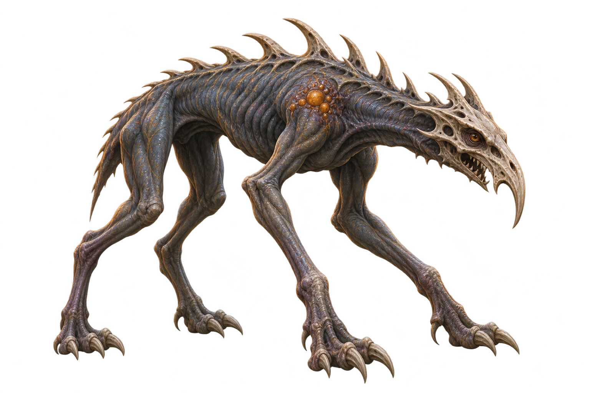
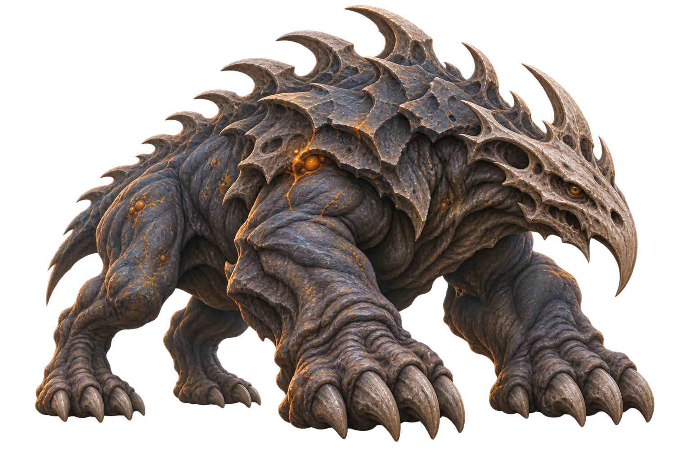
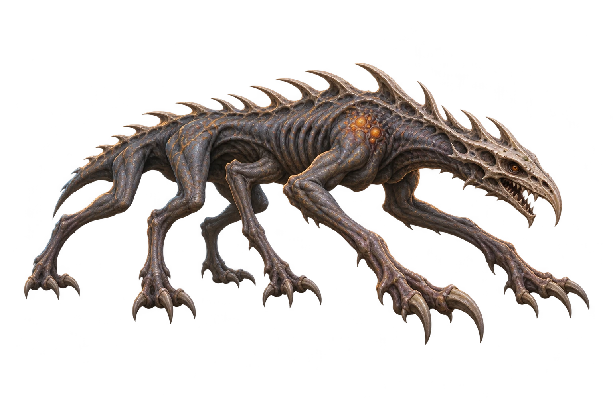
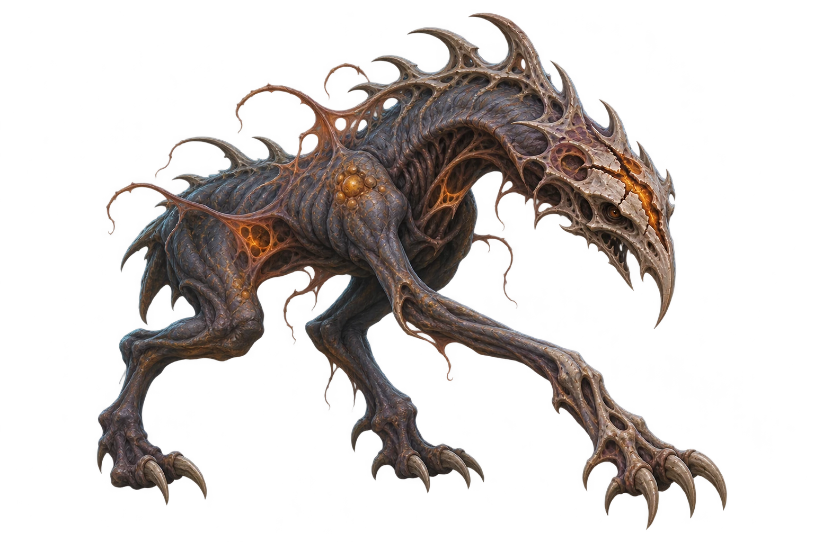

# ART-2 — Creature source intake

This commit contains four WebP reference derivatives and the audit of the owner-supplied PNGs.
The owner will add the original PNGs separately under `docs/art/sources/`; no PNG is included here.
They implement the reference-intake slice of the [art direction](creature-art-direction.md),
not the ART-3 runtime integration. The existing arena art remains in use.

## Source identification

Identify these files by their visible anatomy, not by upload order or old concept-sheet numbers.
The prior chat handoff's filename-to-form list was inconsistent with the actual images.
The canonical form-to-source mapping is the `source` field in [`source-intake.json`](source-intake.json).
The table below summarizes that register against the selected silhouettes in ART-1;
the original filename is the basename of `source`.

| Form | Original upload / expected source path | Visual identification |
| --- | --- | --- |
| Base Creature (Stage 0) | `sources/1000011763.png` | Lean four-legged ancestor, hooked bone mask, ridged back |
| Brute | `sources/1000011765.png` | Low heavy carapace, enormous forepaws |
| Predator | `sources/1000011762.png` | Elongated six-legged stalker, quills, no wings |
| Warped | `sources/1000011764.png` | Split skull, asymmetric occult membranes and tendrils |

| Base Creature | Brute |
| --- | --- |
|  |  |
| Predator | Warped |
|  |  |

Provenance: individual images supplied by the owner in the art-planning conversation,
following the generated creature studies. Original generation identifiers and exact prompts
were not included with these uploads; do not invent them or treat older numbered sheets as
pixel-identical sources. The Warped source here is the Stage 1 quadruped, not the separate
Transcendent inspiration. The original inputs were audited without modification. The WebP derivatives use quality 90,
alpha quality 100 and method 6, at the original dimensions, with no cropping, resizing, retouching
or alpha repair. Decoded alpha is byte-identical to each source; RGB compression is lossy.
The encoder versions and derivative hashes are recorded in the inventory. These are reference
previews, not approved runtime sprites. Preserve the original PNGs when adding them.

## Measured source properties

All four files decode as **1536 × 1024 RGBA PNG**, face right and contain real transparent pixels.
[`source-intake.json`](source-intake.json) records SHA-256, byte length, alpha counts and bounds.
It is an intake inventory, **not a runtime asset manifest** or a family-selection policy.

| Form | Bytes | Fully transparent pixels | Alpha ≥ 128 bounds (source pixels) |
| --- | ---: | ---: | --- |
| Base Creature | 2,125,045 | 1,068,776 | `[139, 47, 1368, 999]` |
| Brute | 2,602,395 | 703,101 | `[78, 12, 1454, 983]` |
| Predator | 1,938,037 | 1,107,276 | `[61, 158, 1477, 865]` |
| Warped | 2,157,283 | 997,266 | `[183, 24, 1371, 1000]` |

Bounds use `[left, top, right exclusive, bottom exclusive]`. They describe pixels, not feet anchors.
The combined original payload is **8,822,760 bytes**. The four committed WebP references total
**1,212,726 bytes**. Both source and reference locations are deliberately outside `table/`.

**Alpha caveat:** every source ranges from 0 to 254, with no fully opaque (255) pixel.
Nonzero-alpha traces extend close to or onto canvas edges, far beyond the principal silhouette.
An RGBA header alone is therefore insufficient evidence of a production-ready cutout.
Do not auto-trim at alpha > 0 or silently threshold away fine claws, membranes or tendrils.
Threshold-128 and threshold-250 bounds in the inventory are diagnostic only.

## Review and ART-3 handoff

- Visual anatomy matches the four ART-1 reference descriptions; the WebP previews are available
  for direct review instead of ambiguous concept numbers.
- The shared slate/ivory/amber treatment is retained. Brute's mass, Predator's long silhouette,
  the base's four legs and Warped's split mask distinguish the forms at source size.
- A browser composite review at 360×210 pixels per image over checkerboard, white, dark slate
  and the existing eclipse background (mirrored) confirmed cutouts without a rectangular matte.
  Fine membranes and dark limbs lose separation against the busy arena; contrast and placement
  still need the actual six-creature Phaser review in ART-3. This source check is not gameplay QA.
- Runtime readiness remains false for every source. ART-3 must determine derivative sizes,
  transparent-padding cleanup if needed, ground anchors and placements without altering originals.
- Check the derivatives over the actual eclipse arena at 1440×1000, 844×390 and 390×844,
  with six creatures, mirrored enemies and the active/target outline. Validate edge contamination,
  warm highlights versus UI gold, small-size silhouette readability and target bounds.
- Preserve fallback and reduced-motion behavior. No gameplay, display names, family precedence,
  mutation layers or spell effects are changed by this intake.

After adding the four original PNGs under the exact paths above, verify their hashes and
measurements with Python and Pillow from the repository root:

```python
import hashlib
import json
from pathlib import Path
from PIL import Image

root = Path("docs/art")
for asset in json.loads((root / "source-intake.json").read_text())["assets"]:
    path = root / asset["source"]
    content = path.read_bytes()
    assert len(content) == asset["sizeBytes"]
    assert hashlib.sha256(content).hexdigest() == asset["sha256"]
    with Image.open(path) as image:
        image.load()
        assert image.mode == asset["mode"]
        assert image.size == (asset["width"], asset["height"])
        alpha = image.getchannel("A")
        counts = alpha.histogram()
        measured = asset["alpha"]
        assert alpha.getextrema() == (measured["min"], measured["max"])
        assert counts[0] == measured["transparentPixels"]
        assert sum(counts[1:255]) == measured["partiallyTransparentPixels"]
        assert counts[255] == measured["opaquePixels"]
        for threshold, bounds in measured["boundsAtLeast"].items():
            mask = alpha.point(lambda value: 255 if value >= int(threshold) else 0)
            assert list(mask.getbbox()) == bounds
    print(asset["form"], "verified")
```

## Verify the committed WebP references

This standalone check needs only the committed files and Python with Pillow; no PNG upload is required.
The `referenceWebp.sha256` values identify the committed bytes. Re-encoding with another Pillow or
libwebp version can produce different bytes, even when dimensions and alpha are unchanged.
The recorded encoder versions and settings describe provenance, not a cross-version byte-reproducibility guarantee.

```python
import hashlib
import json
from pathlib import Path
from PIL import Image

root = Path("docs/art")
for asset in json.loads((root / "source-intake.json").read_text())["assets"]:
    reference = asset["referenceWebp"]
    path = root / reference["path"]
    content = path.read_bytes()
    assert len(content) == reference["sizeBytes"], path
    assert hashlib.sha256(content).hexdigest() == reference["sha256"], path
    with Image.open(path) as image:
        image.load()
        assert image.format == "WEBP", path
        assert image.mode == asset["mode"], path
        assert image.size == (asset["width"], asset["height"]), path
        alpha = image.getchannel("A")
        counts = alpha.histogram()
        measured = asset["alpha"]
        assert alpha.getextrema() == (measured["min"], measured["max"]), path
        assert counts[0] == measured["transparentPixels"], path
        assert sum(counts[1:255]) == measured["partiallyTransparentPixels"], path
        assert counts[255] == measured["opaquePixels"], path
        for threshold, bounds in measured["boundsAtLeast"].items():
            mask = alpha.point(lambda value: 255 if value >= int(threshold) else 0)
            assert list(mask.getbbox()) == bounds, path
    print(asset["form"], "WebP verified")
```
