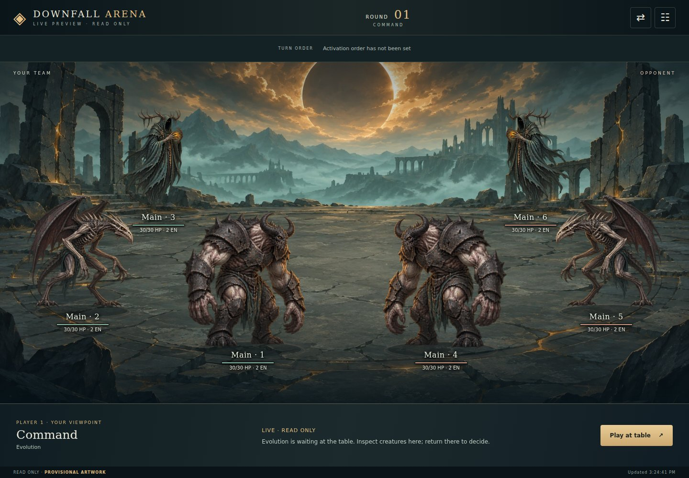
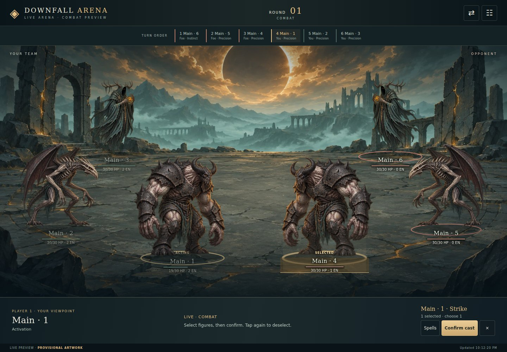
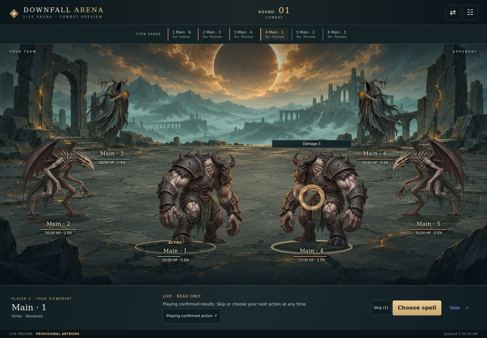
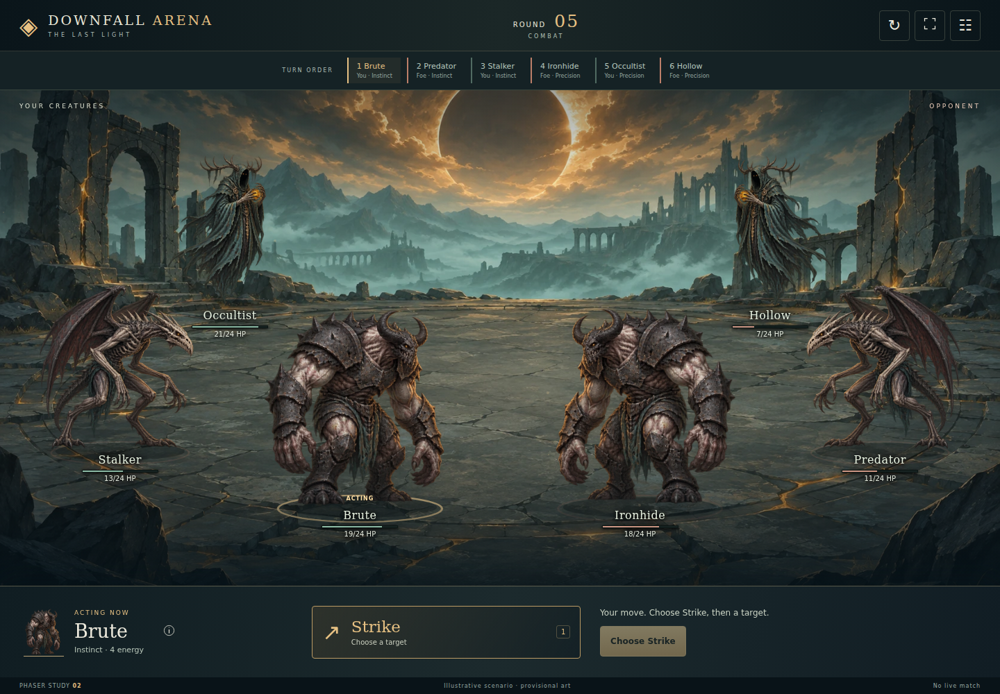
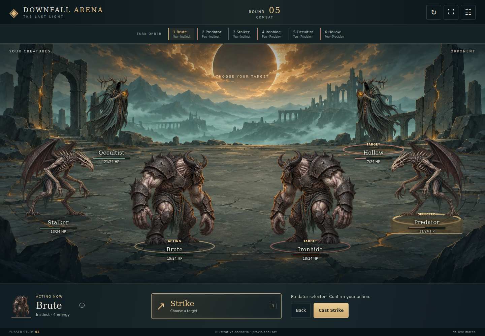
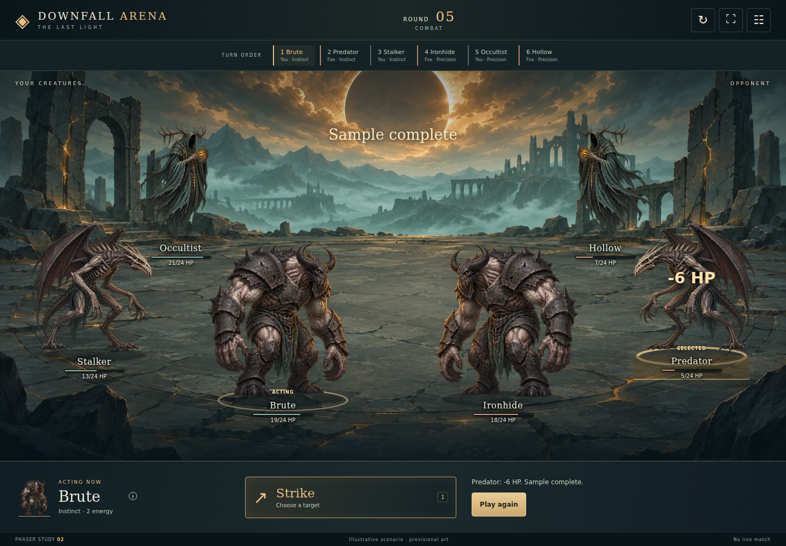

# Browser arena: visual proof of concept and delivery plan

Status: design experiment, not a replacement for the table. First slice: `/arena-lab`.

**Immersive revision (2026-11-03):** A2 now uses Phaser and TypeScript. The canvas, HUD and primary
commands fit the viewport in portrait and landscape. The earlier scrolling DOM study is superseded.
Initial audit: `748557b4` on `main` (player accounts stage 3). A3 refreshes that baseline to `69ce758d`
(#420 merged, on top of player accounts stage 4, #417). Re-check `main` before each integration PR.

## Decision summary

Build a creature-centred presentation over the existing .NET game. Keep the turn-based 3v3 rules,
seat-filtered views, commands, at-activation default and optional hidden-intent mode. The arena is a new
way to see and control the same match; it does not introduce movement, range or real-time combat.

First validate a composition and the feel of one action with authored sample frames. Validate a viewport-bound immersive prototype next. Then integrate a
read-only real board, followed by real commands and a cancellable presentation queue. Do not transplant
`table.js` wholesale or replace the current `/play` until a complete match is supported.

The laboratory is intentionally public, contains only fictional sample data and reaches no API, account,
seat, storage, stream or service worker. Its names and numbers are explicitly illustrative. Existing
content restrictions on production modules remain in force; the future live adapter must use catalogue
text and legal options from the host, never the lab fixture.

## What this PR lets us review

- A locally bundled Phaser battlefield with an eclipse environment and three illustrated creature forms
  reused across two teams. Ambient motes, idle movement, lunge, recoil, impact sparks and camera shake.
- One sample action with three authored outcomes, including defeat. No browser-side damage rules.
- Accessible DOM targets, explicit confirmation/cancellation, inspection and settings overlays, reset,
  skip, 1×/2× playback, optional sound, keyboard controls and system/manual reduced motion.
- Distinct portrait and landscape formations; no document scrolling or offscreen primary commands at
  the tested sizes. Rotation resizes the stage and settles any in-flight presentation.
- Local art loading, selectable missing-art fallback and renderer-error reload UI.

Build once, then run the existing host and visit `/arena-lab`:

```bash
npm --prefix arena ci --ignore-scripts
npm --prefix arena run build
dotnet run --project src/DownfallArena.Cli -- table --lobby
```

For a design-only preview after the build, run `python3 -m http.server 8765` from the repository root
and open `http://127.0.0.1:8765/table/arena-lab.html`. The lobby link requires the actual host.
See [arena/README.md](../../arena/README.md) for packaging and the presentation boundary.

## Art direction and review questions

**Creature, mutation and spell visual direction:** [art direction bible](../art/creature-art-direction.md) supersedes the older provisional sprite descriptions below. Bright warm gold stays reserved for active/selected-target UI highlighting; creature amber/ochre is subtler, with silhouette and value contrast doing the identification.

**Proposed direction:** a ruined ritual arena under an eclipse. Charcoal and desaturated green establish the
world; warm gold identifies the active creature and selected target. Team colours supplement textual labels.
Use the creatures' silhouettes as the dominant shapes, keep numbers and labels outside the artwork, and
keep the command panel in the same place across decision and targeting.

The provisional generated environment and transparent sprite sheet test creature presence and silhouette
readability. They are not final catalogue art: each team reuses the same three forms, with the enemy team
mirrored and tinted. See [art provenance](../../arena/ART.md). Skeletal animation and 3D remain deferred.

| Review | Accept when | Reject when |
| --- | --- | --- |
| Creature presence | The board reads as two teams of three; active creature is identifiable immediately | The player must read the command panel to find the actor |
| Decision | Action, actor and current resources are visible together | Artwork or decoration hides a game value |
| Targeting | Tap a creature, see its selected state, explicitly confirm or cancel | A second accidental tap commits a decision |
| Resolution | Identify target, actual HP change and defeat without reading a log | Numbers overlap labels or animation obscures the next choice |
| Viewport | No document scrolling in either axis at 390×844, 844×390 and 1440×1000; arena and primary commands remain visible | Hiding overflow clips required controls or shrinking text makes it unreadable |
| Phone | At least 44 px touch controls, portrait-specific composition, paged actions and inspect overlays | Six tiny cards squeezed into a desktop layout |
| Accessibility | Keyboard operation, visible focus, non-colour selection labels, reduced motion | The player must wait for movement or rely on colour |

Review the same action in portrait and landscape, including the lowest-health target, with motion on and off.
Decide the composition, figure scale, command position and tolerable timing before adding live commands.
The lab uses a sample impact after 420 ms and settles at 1,250 ms (halved at 2×); these are tuning starting
points, not minimum waiting times for a real match. Skip and reduced motion always reach the same final state.

## Repository audit: integration points already present

| Concern | Existing source | Use in the next slice |
| --- | --- | --- |
| Authoritative game | `Domain/Matches`, application command/query handlers | Leave the rules and random draws here |
| Legal questions | `src/DownfallArena.Cli/Table/TableApi.cs`, `table/slot.js` | Read `waitingFor`, `waitingAsked`, `waitingCreature` and `options.action`; adapt with `slotView` |
| Public/private boundary | `Application/Matches/Feed/SeatFeedProjection.cs`, `TableApi.SeatAsync` | Consume the seat projection, never a full trace during a live game |
| Exact action boundaries | ADR 0075, `table/replay.js` | Use `CombatActionFrame.before/after`; do not infer an individual hit from two arbitrary polls |
| Existing feedback primitive | `table/combat-fx.js` | Reuse `combatSnapshot` / `combatChanges` for displayed stat deltas |
| Public action sequence | `table/feed.js` | Reuse action extraction, sequencing and round handling instead of parsing narration |
| Initiative and terms | `table/timeline.js`, `table/terms.js` | Preserve host order; show Instinct / Precision and player phase names |
| Seat/session transport | `table/transport.js`, `session.js`, `seats.js`, `invitation.js` | Reuse accepted seat and account boundaries; a view must not claim a seat by opening a URL |
| Refresh notification | ADR 0119, `TableChanges`, `table/transport.js` | SSE says to refetch; the seat response remains authoritative |
| Serving and packaging | `TableFiles.cs`, `Dockerfile`, CLI tests | Explicit static routes; verify every imported asset is served and copied |

Paths in the Domain/Application rows are relative to their respective `src/DownfallArena.*` project.
`table.js` currently owns substantial orchestration (seat, question acknowledgement, historical presentation,
upkeep and opponent actions). The live integration must extract a narrow controller boundary with behaviour
coverage, rather than mounting two page entry points with competing polls or acknowledgements.

### Contract for the live presentation

Keep these three things separate:

1. **Latest seat view:** current authoritative board, legal options and question identity.
2. **Presented frame:** temporary historical board for one confirmed action; never a command source.
3. **Pending local choice:** selected spell and targets, tied to the seat and `waitingAsked` question identity.

The controller accepts a new seat view, invalidates a stale local choice, and supplies ordered public action
frames to the presenter. Only the current legal question can submit a command. A finished animation never
submits a command or advances the domain. The acknowledgement that a question was shown waits until the
question is actually visible, as the existing table already requires.

`combatChanges` alone is not an animation queue: a poll can include multiple actions and the last combat
frame can precede cleanup/upkeep. Event sequence identifies individual actions. `feedNext` is the host's
cursor over examined entries, not a contiguous sequence of public events: private entries create legitimate
gaps. Do not treat such gaps as missed public actions or fetch another seat to fill them.

On a first load, seat/table change, return from a hidden tab or explicit skip, prefer the latest authoritative
state to replaying an unbounded history. Older events without frames get a labelled textual result. On
reconnect, deduplicate by table/seat/event identity, bound the queue and cancel previous generation callbacks.
An exact policy for how many queued actions to replay belongs in the synchronization PR and its tests.

## PR sequence and acceptance criteria

Numbers below belong to this arena workstream, not the earlier UI-polish PR list.

| PR | Scope and main files | Acceptance / tests | Depends on |
| --- | --- | --- | --- |
| A1 — Design laboratory (implemented) | `table/arena-lab*`, explicit host routes, this plan | Compare two layouts; one action with three fixed outcomes; cancel/reset/skip/reduced-motion tests; route test | Current main |
| A2 — Immersive viewport prototype (implemented in this PR) | Phaser/TypeScript renderer spike, viewport shell, layered environment, three provisional forms, HUD and asset mapping | No document scrolling or clipped commands; visible actor/targets/action bar; decision/targeting/resolution at 1440×1000, 844×390 and 390×844; missing-art fallback | A1 design review |
| A3 — Presentation/controller boundary (implemented) | `table/presentation.js` extracts local question adaptation, historical display selection and team/timeline mapping; `/play` consumes it | Frozen-input tests cover seat/asking changes, historical resources, public event cutoffs, host order and missing frames; browser journeys exercise the existing renderer | A1; based on `69ce758d` including #420 fixes |
| A4 — Real board, read-only (implemented) | Opt-in arena route over existing authenticated seat transport | Correct seat projection, account/invitation handling, dead/stunned/condition states, reconnect; no decisions emitted | A3 |
| A5 — Real action and target controls (implemented) | Existing `slotView`/command builder + scene targets + catalogue-backed action list | At-activation and hidden-intent paths, friendly/self/multiple/no-target spells, unaffordable/unavailable cards, stale asking, server rejection, double-click prevention | A2, A4 |
| A6 — Confirmed-action playback (implemented) | Ordered frame queue, action motifs, existing `combat-fx` + `feed`/`replay` helpers | No duplicate effects from SSE/poll; multiple events in one response; final action before upkeep; skip/reconnect/hidden tab; legacy frame fallback | A4; integrate A5 |
| A7 — Complete game loop (implemented) | Mutation Tree, Tempo/ties, upkeep, aftermath, result and replay in the scene shell | Complete 3v3 match, simultaneous choices, eliminated creatures, round cap, concession, finished-session replay | A5, A6 |
| A8 — Release candidate | Sound opt-in, art coverage, device performance, accessibility, rollout toggle | Full match on desktop + Android + iOS; compare with existing UI; retained fallback; recorded performance and asset budgets | A7 |

A3/A4 can use the provisional art while A2 is reviewed. A5 must land with the current instant/state-only
result path available; A6 enriches that path rather than making animation completion mandatory. Do not
replace `/play` in any of A1–A6. Audit account work and table orchestration changes on `main` before A3/A4.

### A3 delivery boundary

`table/presentation.js` is now the shared, framework-independent mapping used by the current table, served
through the real host's explicit route table. See its [contract](../../table/README.md#read-only-presentation-boundary).
The latest seat response, locally adapted question and displayed historical board remain distinct. The
module neither polls nor sends commands and does not own hotseat selection or acknowledgement timing.

This step intentionally leaves `/arena-lab` on its sample state machine: wiring a real seat belongs to A4.
Parity today is tested between the shared board model and `/play`; parity with a live Phaser renderer can
only be asserted once A4 exists. A4 must use a separate entry point and must not import the lab fixture or
start a second instance of `table.js`. Refresh `main` again before implementing that transport lifecycle.

### A4 delivery boundary

Built on `main` at `96edfe27` after PR #425 merged, including its replay guard, preserved asked creature,
fixture-based browser assertions and choice-field analyser correction. The account result changes from
#421 are included in the integration baseline.
[ADR 0125](../adr/0125-read-one-authenticated-seat-in-the-live-arena.md) records live adoption without
rewriting the accepted prototype decision.

`/arena` asks for a viewpoint, resumes accepted seats through the lobby, and displays the selected
seat's host board through `boardPresentation`. It reads one seat only, never claims an invitation,
never sends a decision or `shown`, and does not replace saved `/play` seats. The existing host's read
routes still mark that accepted seat as arrived. `/play` now links to the opt-in preview; decisions
remain there. The laboratory retains its fictional state and cannot enter the live dependency graph.

One-, two- and three-creature teams, activation order, health, energy, defense, stun, immunity,
conditions, spell inspection and match completion use live data. SSE refresh, polling fallback,
bounded stream reconnect, stale-state labels and generation fencing cover the transport lifecycle.
Revocation clears every private surface; a viewpoint change requires another explicit selection.

Validation adds deterministic controller/discovery tests, mobile/desktop browser journeys and a real
host journey that advances the match from another client. The artwork remains provisional, and this
step deliberately has no action controls or combat playback. A5 is the next slice.

Screens captured from the actual .NET host in this slice (Evolution, before decisions):



[Live arena on phone](images/arena-live/phone.jpg)

### A5 delivery boundary

Built on `main` at `91ee9554`, including the fixes merged in #427, Phaser 4.2.1 and the player labels
from #428. [ADR 0126](../adr/0126-answer-combat-questions-in-the-live-arena.md) extends A4 with explicit
combat controls. The A4 description above records the earlier read-only slice.

Opening the spell/target controls acknowledges that question; inspection alone remains read-only.
Action uses local spell selection followed by field targets and explicit confirmation. Hidden Intent
and its later Target are separate confirmations. Catalogue text and host options supply every choice;
known unoffered spells are disabled and unaffordable hidden plans warn that they may fizzle.

A pure controller fences drafts by seat and asking, revalidates before posting, prevents duplicate
writes, and exposes server refusals or uncertain outcomes without automatic write retries. The
connection discards pre-command reads and refreshes after every command outcome. Scene selection is
presentation only. Results arrive immediately as authoritative snapshots; A6 adds playback later.
Mutation, Tempo and tie questions still return to `/play` until A7. Acknowledging on opening the controls
starts the decision clock later than the table does and lets a push notice reach a device already reading the
arena; ADR 0126 accepts both. A refusal (the other client answered first) stays on the dock until the player's
next move.

Validation includes deterministic controller/transport tests, mobile/desktop combat journeys,
unchanged lab/read-only regression journeys, and both combat declarations against the real .NET host.

Captured from the real host during A5 combat:



[Targeting on phone](images/arena-combat/phone.jpg) · [Spell choices on phone](images/arena-combat/spells.jpg)

### A6 delivery boundary

Built on the merged A5 (#430), including its control/transport fixes. [ADR 0127](../adr/0127-play-confirmed-actions-in-the-live-arena.md)
adds ordered playback of the public CombatActionResolved frames. Each action uses its own before/after board;
multiple arrivals and the final cast before upkeep or match completion retain their order. Applied damage
hits every affected target; recovery, energy and conditions pulse; fizzles do not hit; deaths use the frame.

The per-viewpoint watermark consumes identities at receipt, preventing SSE/poll duplicates and replays after
Skip. Playback never sends commands or acknowledges a question. Skip and opening controls immediately draw
the latest legal board. Resize, motion preference changes and connection interruption cancel effects;
seat changes, access loss and hidden pages erase private historical content and fence callbacks. First reads
are baselines. Legacy frames, and one read bringing more than twelve actions, settle on the latest board with
confirmed text; what is already queued plays on.
Reduced motion presents applied frames without displacement or particles. An expandable result keeps the full
outcome readable without growing the fixed shell. Upkeep choreography and complete-loop controls remain A7.

Validation includes pure queue tests, mobile/desktop playback and lifecycle scenarios, the three existing
arena browser suites, and both declaration modes against the real host. The real-host journeys compare
every observed windup/impact stat with the exact event frame received from that host.

Captured during a real-engine Strike on desktop and phone:



[Confirmed combat on phone](images/arena-playback/phone.jpg)

### A7 delivery boundary

Built on the merged A6 (#431). [ADR 0128](../adr/0128-complete-the-game-loop-in-the-arena.md) completes the
loop in the scene shell: Mutation Tree selection, per-creature Tempo confirmation, grouped tie ordering,
upkeep and aftermath review, concession, the host's match result and a manual whole-match replay. Both combat
declarations complete a 3v3 match through the arena controls, and two browser contexts verify simultaneous
private choices before a concession. A finished session opens at `/arena?replay=<session>&seat=player1` under
the existing operator access. The table remains the invitation and recovery route; A8 release acceptance is
still pending.

[Mutation Tree on phone](images/arena-loop/phone-mutations.jpg) ·
[Recorded match on desktop](images/arena-loop/desktop-replay.jpg)

## Revised immersive prototype (A2)

The maintainer authorized the **Phaser + TypeScript** spike. [ADR 0123](../adr/0123-prototype-the-arena-as-an-isolated-presentation.md)
records the scoped dependency and build decision. The .NET engine and existing API boundary remain
unchanged. The implementation proves one action's presentation; live play is still a separate workstream.
The following direction continues to guide A3–A8:

- Stage fills the available viewport (including browser chrome and safe-area insets); an optional fullscreen
  button is a convenience, never a prerequisite for fitting the interface.
- Large figures stand on a layered battlefield with foreground/background depth, ambient movement, short
  attack/recoil sequences and controlled impact emphasis. The scene is the primary visual surface.
- A compact HUD holds round/timeline and primary actions. Creature details, Mutation Tree and log open as
  dismissible overlays; they do not extend the document. Long spell lists use pages/categories rather than
  squeezing every spell into view. Internal reference scrolling, if needed, remains inside an explicit overlay.
- Portrait gets a distinct layout; landscape is the main cinematic composition. Do not solve portrait by
  scaling desktop text down. If portrait cannot meet legibility and control size, document that finding and
  review an orientation policy rather than silently forcing rotation.
- The first immersive slice needs one convincing 10–15 second action sequence, not six final creature rigs:
  select, target, wind-up, impact, reaction, result, next activation. Reuse the existing sample frames.
- Acceptance includes both `scrollWidth <= viewport width` and `scrollHeight <= viewport height`, visible
  hit targets and commands, reduced motion, UI zoom, short viewports and browser-bar resize. Setting
  `overflow: hidden` alone is not evidence that the experience fits.

Primary references consulted for the renderer recommendation:
[engine options on Poki](https://developers.poki.com/guide/web-engine),
[Phaser scenes](https://docs.phaser.io/phaser/concepts/scenes),
[Phaser scaling](https://docs.phaser.io/phaser/concepts/scale-manager),
[PixiJS](https://pixijs.com/).

## Asset and performance starting constraints

- Three illustrated forms reused across the lab; six distinct finished creatures are a later art task.
- Later asset manifest: presentation identifier → image source, aspect ratio, anchor and fallback; separate
  from combat rules. Asset absence never prevents selecting a legal target.
- Aim for at most 2 MB of initially loaded scene art and no external font request; measure before accepting
  final illustrations. Do not preload every mutation or spell effect.
- Prefer transform/opacity for movement; do not reconstruct the entire board on every animation frame.
- Effects should remain short, cancellable and skippable. The lab has optional synthesized impact sound; sound must
  not be the only way to learn that an action occurred.

## Validation checklist

- `node --test studio/*.test.js table/*.test.js`.
- `dotnet build`, `dotnet test`, `dotnet format --verify-no-changes` (requires the .NET 10 SDK).
- Browser checks: both orientations, all three target outcomes, cancel, reset while animating, skip, 2×, keyboard
  focus, system/manual reduced motion, hidden-tab return and no API calls.
- Browser regression suite: `cd studio/browser && npm ci --ignore-scripts && npx playwright install chromium`,
  then `npm test -- arena-lab.spec.js`; the existing Studio browser workflow includes it and retains screenshots.
- Screens: 1440×1000 desktop, 844×390 landscape, 390×844, 320×740 and 320×568 portrait; check both axes and control bounds.
- Run the .NET-hosted `/arena-lab` route as well as a static preview before merging.

## Captured Phaser prototype

Actual browser screenshots of the interactive implementation, captured through the .NET host. Each image
is a single viewport, not a full-page scrolling capture. The earlier DOM study's captures live in this branch's
history, not in the tree: nothing refers to them any more.



| Target selected | Sample action resolved |
| --- | --- |
|  |  |

[Phone portrait](images/arena-lab/phaser-portrait.png) · [Phone landscape](images/arena-lab/phaser-landscape.png)
