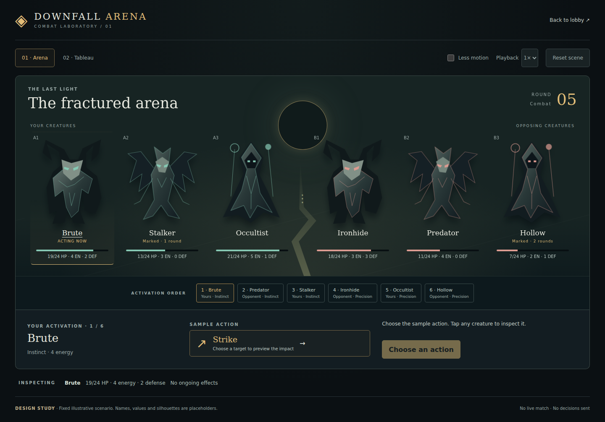
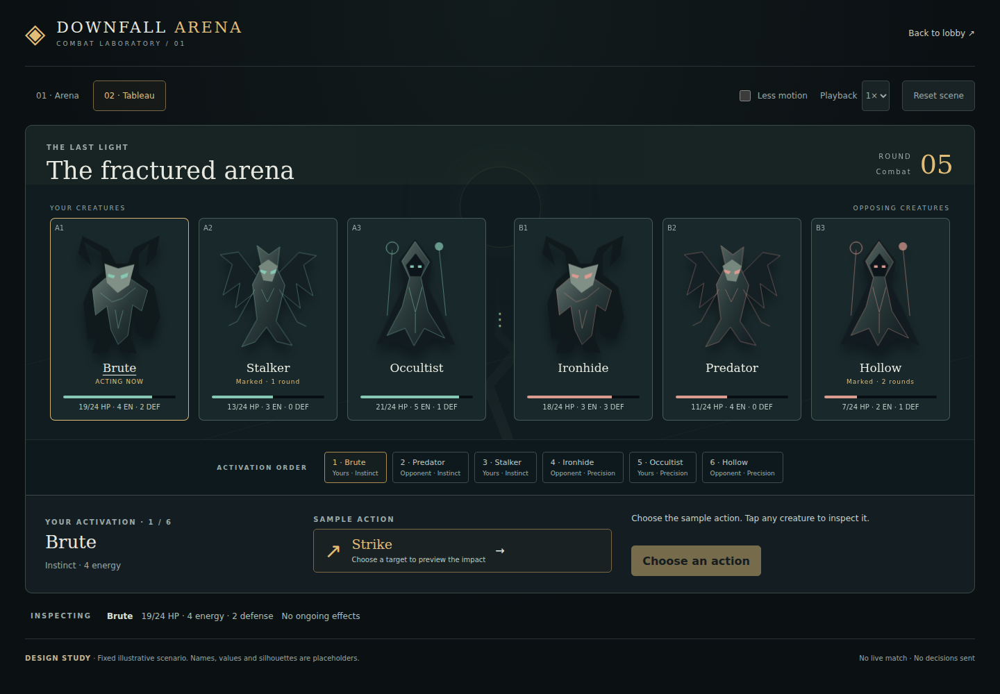
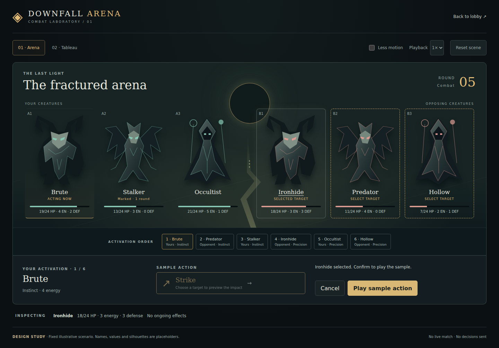
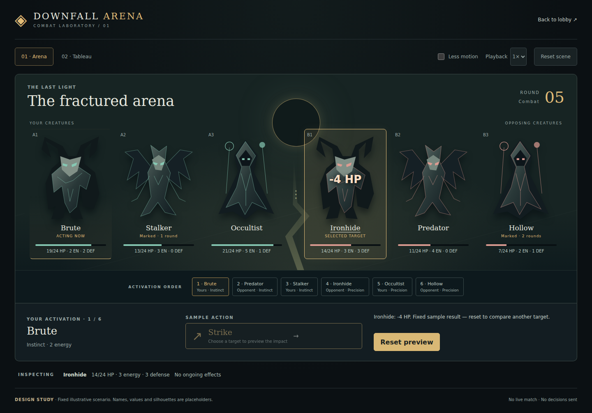

# Browser arena: visual proof of concept and delivery plan

Status: design experiment, not a replacement for the table. First slice: `/arena-lab`.

**Direction clarified after the first screenshots (2026-11-03):** the target is an immersive browser game
that fits the available viewport, like a game embedded on Poki. The current scrollable laboratory is an
interaction baseline, not the accepted visual direction. A2 must replace the page composition with a
viewport-bound game stage before live-match integration proceeds.
Baseline inspected: `748557b4` on `main` (player accounts stage 3). Re-check `main` before each integration PR.

## Decision summary

Build a creature-centred presentation over the existing .NET game. Keep the turn-based 3v3 rules,
seat-filtered views, commands, at-activation default and optional hidden-intent mode. The arena is a new
way to see and control the same match; it does not introduce movement, range or real-time combat.

First validate a composition and the feel of one action with authored sample frames. Validate a viewport-bound immersive prototype next. Then integrate a
read-only real board, followed by real commands and a cancellable presentation queue. Do not transplant
`table.js` wholesale or replace the current `/play` until a complete match is supported.

The laboratory is intentionally public, contains only fictional sample data and reaches no API, account,
seat, storage, stream or service worker. Its names and numbers are explicitly illustrative. Existing
content restrictions on production modules remain in force; the future live adapter must use catalogue
text and legal options from the host, never the lab fixture.

## What this first PR lets us review

- Six provisional SVG silhouettes with health, energy, defense, conditions and an inspected-creature summary.
- Two compositions of exactly the same scenario: **Arena** (figures in shared space) and **Tableau** (framed
  figures). Changing composition preserves the selected target and the displayed state.
- Three review states: decision, targeting and resolution. One illustrative action has three authored target
  outcomes, including a defeat. Nothing calculates combat damage or costs in the browser.
- Selection, explicit confirmation, cancellation, inspect, reset, skip, 1×/2× playback, reduced motion and
  a stable activation order using the existing player-facing terminology.
- Desktop and landscape put teams side by side. The initial narrow portrait stacks opponents above allies and scrolls vertically. This is a known
  limitation of A1, explicitly rejected as the final interaction model after screenshot review.

Run the existing host and visit `http://127.0.0.1:5099/arena-lab`:

```bash
dotnet run --project src/DownfallArena.Cli -- table --lobby
```

For a design-only preview without .NET, from the repository root:

```bash
python3 -m http.server 8765
# http://127.0.0.1:8765/table/arena-lab.html
```

The static preview's lobby link requires the real host. No build step or third-party renderer is needed.
This PR is a thin sample across the original scene/interaction/animation ideas, not completion of the
full interaction and animation milestones below.

## Art direction and review questions

**Proposed direction:** a ruined ritual arena under an eclipse. Charcoal and desaturated green establish the
world; warm gold identifies the active creature and selected target. Team colours supplement textual labels.
Use the creatures' silhouettes as the dominant shapes, keep numbers and labels outside the artwork, and
keep the command panel in the same place across decision and targeting.

The provisional SVG forms test occupancy, contrast and silhouettes. They are not proposed final creature
art. Before commissioning six portraits, produce one finished creature and one environment crop and check
that readable eyes, limbs and target outlines survive the smallest layout. A reusable static illustration
with small transforms is enough for this experiment; skeletal animation and 3D are deferred.

| Review | Accept when | Reject when |
| --- | --- | --- |
| Creature presence | The board reads as two teams of three; active creature is identifiable immediately | The player must read the command panel to find the actor |
| Decision | Action, actor and current resources are visible together | Artwork or decoration hides a game value |
| Targeting | Tap a creature, see its selected state, explicitly confirm or cancel | A second accidental tap commits a decision |
| Resolution | Identify target, actual HP change and defeat without reading a log | Numbers overlap labels or animation obscures the next choice |
| Viewport | In A2, no document scrolling in either axis at 390×844, 844×390 and 1440×1000; arena and primary commands remain visible | Hiding overflow clips required controls or shrinking text makes it unreadable |
| Phone | At least 44 px touch controls, portrait-specific composition, paged actions and inspect overlays | Six tiny cards squeezed into a desktop layout |
| Accessibility | Keyboard operation, visible focus, non-colour selection labels, reduced motion | The player must wait for movement or rely on colour |

Review the same action in both compositions, including the lowest-health target, with motion on and off.
Decide the composition, figure scale, command position and tolerable timing before replacing the silhouettes.
The lab uses a sample impact after 420 ms and settles at 1,250 ms (halved at 2×); these are tuning starting
points, not minimum waiting times for a real match. Skip and reduced motion always reach the same final state.

## Repository audit: integration points already present

| Concern | Existing source | Use in the next slice |
| --- | --- | --- |
| Authoritative game | `Domain/Matches`, application command/query handlers | Leave the rules and random draws here |
| Legal questions | `src/DownfallArena.Cli/Table/TableApi.cs`, `table/slot.js` | Read `waitingFor`, `waitingAsked`, `waitingCreature` and `options.action`; adapt with `slotView` |
| Public/private boundary | `Application/Matches/Feed/SeatFeedProjection.cs`, `TableApi.SeatAsync` | Consume the seat projection, never a full trace during a live game |
| Exact action boundaries | ADR 0075, `table/replay.js` | Use `CombatActionFrame.before/after`; do not infer an individual hit from two arbitrary polls |
| Existing feedback primitive | `table/combat-fx.js` | Reuse `combatSnapshot` / `combatChanges` for displayed stat deltas |
| Public action sequence | `table/feed.js` | Reuse action extraction, sequencing and round handling instead of parsing narration |
| Initiative and terms | `table/timeline.js`, `table/terms.js` | Preserve host order; show Instinct / Precision and player phase names |
| Seat/session transport | `table/transport.js`, `session.js`, `seats.js`, `invitation.js` | Reuse accepted seat and account boundaries; a view must not claim a seat by opening a URL |
| Refresh notification | ADR 0119, `TableChanges`, `table/transport.js` | SSE says to refetch; the seat response remains authoritative |
| Serving and packaging | `TableFiles.cs`, `Dockerfile`, CLI tests | Explicit static routes; verify every imported asset is served and copied |

Paths in the Domain/Application rows are relative to their respective `src/DownfallArena.*` project.
`table.js` currently owns substantial orchestration (seat, question acknowledgement, historical presentation,
upkeep and opponent actions). The live integration must extract a narrow controller boundary with behaviour
coverage, rather than mounting two page entry points with competing polls or acknowledgements.

### Contract for the live presentation

Keep these three things separate:

1. **Latest seat view:** current authoritative board, legal options and question identity.
2. **Presented frame:** temporary historical board for one confirmed action; never a command source.
3. **Pending local choice:** selected spell and targets, tied to the seat and `waitingAsked` question identity.

The controller accepts a new seat view, invalidates a stale local choice, and supplies ordered public action
frames to the presenter. Only the current legal question can submit a command. A finished animation never
submits a command or advances the domain. The acknowledgement that a question was shown waits until the
question is actually visible, as the existing table already requires.

`combatChanges` alone is not an animation queue: a poll can include multiple actions and the last combat
frame can precede cleanup/upkeep. Event sequence identifies individual actions. `feedNext` is the host's
cursor over examined entries, not a contiguous sequence of public events: private entries create legitimate
gaps. Do not treat such gaps as missed public actions or fetch another seat to fill them.

On a first load, seat/table change, return from a hidden tab or explicit skip, prefer the latest authoritative
state to replaying an unbounded history. Older events without frames get a labelled textual result. On
reconnect, deduplicate by table/seat/event identity, bound the queue and cancel previous generation callbacks.
An exact policy for how many queued actions to replay belongs in the synchronization PR and its tests.

## PR sequence and acceptance criteria

Numbers below belong to this arena workstream, not the earlier UI-polish PR list.

| PR | Scope and main files | Acceptance / tests | Depends on |
| --- | --- | --- | --- |
| A1 — Design laboratory (this PR) | `table/arena-lab*`, explicit host routes, this plan | Compare two layouts; one action with three fixed outcomes; cancel/reset/skip/reduced-motion tests; route test | Current main |
| A2 — Immersive viewport prototype | Phaser/TypeScript renderer spike, viewport shell, layered environment, one finished creature, HUD and asset mapping | No document scrolling or clipped commands; visible actor/targets/action bar; decision/targeting/resolution at 1440×1000, 844×390 and 390×844; missing-art fallback | A1 design review |
| A3 — Presentation/controller boundary | Extract minimal read-only view mapping from table orchestration; focused modules/tests | Both interfaces agree on creature values, initiative and asking; existing `/play` behaves unchanged | A1; refresh main |
| A4 — Real board, read-only | Opt-in arena route over existing authenticated seat transport | Correct seat projection, account/invitation handling, dead/stunned/condition states, reconnect; no decisions emitted | A3 |
| A5 — Real action and target controls | Existing `slotView`/command builder + scene targets + catalogue-backed action list | At-activation and hidden-intent paths, friendly/self/multiple/no-target spells, unaffordable/unavailable cards, stale asking, server rejection, double-click prevention | A2, A4 |
| A6 — Confirmed-action playback | Ordered frame queue, action motifs, existing `combat-fx` + `feed`/`replay` helpers | No duplicate effects from SSE/poll; multiple events in one response; final action before upkeep; skip/reconnect/hidden tab; legacy frame fallback | A4; integrate A5 |
| A7 — Complete game loop | Mutation Tree, Tempo/ties, upkeep, aftermath, result and replay in the scene shell | Complete 3v3 match, simultaneous choices, eliminated creatures, round cap, concession, finished-session replay | A5, A6 |
| A8 — Release candidate | Sound opt-in, art coverage, device performance, accessibility, rollout toggle | Full match on desktop + Android + iOS; compare with existing UI; retained fallback; recorded performance and asset budgets | A7 |

A3/A4 can use the provisional art while A2 is reviewed. A5 must land with the current instant/state-only
result path available; A6 enriches that path rather than making animation completion mandatory. Do not
replace `/play` in any of A1–A6. Audit account work and table orchestration changes on `main` before A3/A4.

## Revised immersive prototype (A2)

This is a presentation recommendation, not an approved framework migration. Evaluate **Phaser + TypeScript**
for the next isolated scene: scene lifecycle, camera, animation/tweens, input, audio and scaling are relevant
here. **PixiJS** remains an alternative if a rendering layer plus our own orchestration proves simpler.
Unity is not required to create this kind of browser experience. Preserve the .NET authority and the API
boundary; choosing a renderer does not imply rewriting the combat engine in JavaScript or Unity C#.
A2 must amend the ADR before adding a pinned renderer/build pipeline and must explain deployment, asset
packaging and accessible DOM controls alongside the rendered scene.

- Stage fills the available viewport (including browser chrome and safe-area insets); an optional fullscreen
  button is a convenience, never a prerequisite for fitting the interface.
- Large figures stand on a layered battlefield with foreground/background depth, ambient movement, short
  attack/recoil sequences and controlled impact emphasis. The scene is the primary visual surface.
- A compact HUD holds round/timeline and primary actions. Creature details, Mutation Tree and log open as
  dismissible overlays; they do not extend the document. Long spell lists use pages/categories rather than
  squeezing every spell into view. Internal reference scrolling, if needed, remains inside an explicit overlay.
- Portrait gets a distinct layout; landscape is the main cinematic composition. Do not solve portrait by
  scaling desktop text down. If portrait cannot meet legibility and control size, document that finding and
  review an orientation policy rather than silently forcing rotation.
- The first immersive slice needs one convincing 10–15 second action sequence, not six final creature rigs:
  select, target, wind-up, impact, reaction, result, next activation. Reuse the existing sample frames.
- Acceptance includes both `scrollWidth <= viewport width` and `scrollHeight <= viewport height`, visible
  hit targets and commands, reduced motion, UI zoom, short viewports and browser-bar resize. Setting
  `overflow: hidden` alone is not evidence that the experience fits.

Primary references consulted for the renderer recommendation:
[engine options on Poki](https://developers.poki.com/guide/web-engine),
[Phaser scenes](https://docs.phaser.io/phaser/concepts/scenes),
[Phaser scaling](https://docs.phaser.io/phaser/concepts/scale-manager),
[PixiJS](https://pixijs.com/).

## Asset and performance starting constraints

- Three silhouette forms reused across the lab; six distinct finished creatures are a later art task.
- Later asset manifest: presentation identifier → image source, aspect ratio, anchor and fallback; separate
  from combat rules. Asset absence never prevents selecting a legal target.
- Aim for at most 2 MB of initially loaded scene art and no external font request; measure before accepting
  final illustrations. Do not preload every mutation or spell effect.
- Prefer transform/opacity for movement; do not reconstruct the entire board on every animation frame.
- Effects should remain short, cancellable and skippable. Sound is initially absent; later opt-in sound must
  not be the only way to learn that an action occurred.

## Validation checklist

- `node --test studio/*.test.js table/*.test.js`.
- `dotnet build`, `dotnet test`, `dotnet format --verify-no-changes` (requires the .NET 10 SDK).
- Browser checks: both layouts, all three target outcomes, cancel, reset while animating, skip, 2×, keyboard
  focus, system/manual reduced motion, hidden-tab return and no API calls.
- Browser regression suite: `cd studio/browser && npm ci --ignore-scripts && npx playwright install chromium`,
  then `npm test -- arena-lab.spec.js`; the existing Studio browser workflow includes it and retains screenshots.
- Screens: 1440×1000 desktop, 844×390 landscape, 390×844 and 360×800 portrait; check horizontal overflow.
- Run the .NET-hosted `/arena-lab` route as well as a static preview before merging.

## Captured prototype

These are actual browser captures of this PR, not final-art mockups. Desktop and phone composition captures
come from the browser regression suite; targeting and resolution were also exercised through the .NET
host's `/arena-lab` route. The landscape capture is full-page: the page deliberately scrolls vertically.

| Arena, desktop | Tableau, desktop |
| --- | --- |
|  |  |

| Target selected | Sample action resolved |
| --- | --- |
|  |  |

[Phone portrait](images/arena-lab/phone-portrait.png) · [Phone landscape](images/arena-lab/phone-landscape.png)
