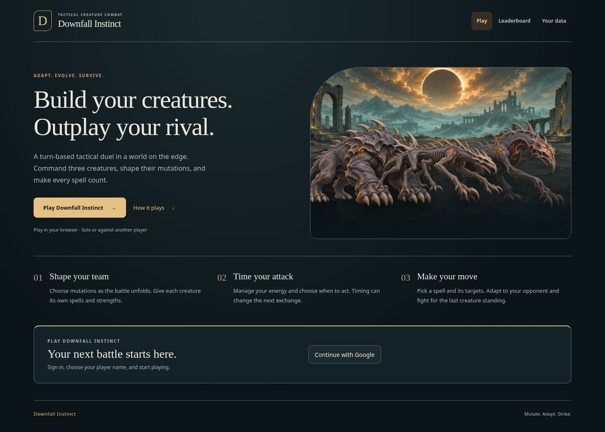
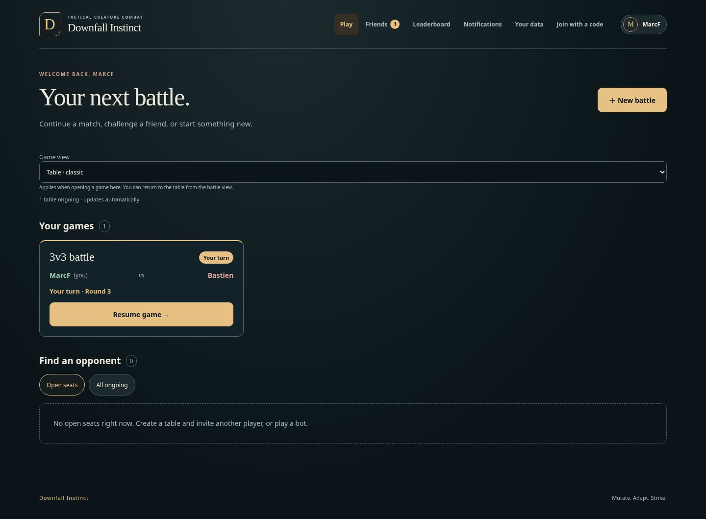
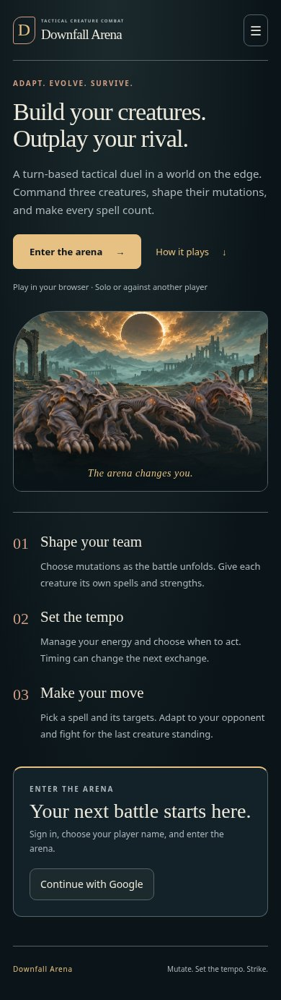
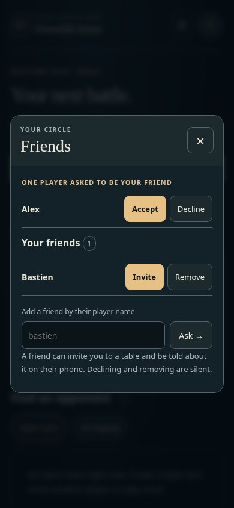

# Home navigation

The public [showcase](../../showcase/README.md) introduces the game. The application home brings a player
to sign-in or to their next battle. Both use the [official palette](../art/branding.md).

## Page states

- **Signed out on an account host:** the player sees sign-in immediately, in a short panel: one line on the game,
  what an account gives, and the ground and a creature as pictures of the kit. The showcase is the introduction,
  reached from the footer. A visitor who follows a friend's invitation is told who invites them and to what,
  which the host answers to whoever holds the link (`POST /api/lobby/invitations`). Google sign-in and the local
  developer form use the existing account flow. Operator notices and account errors appear on this screen.
  [`accounts-plan.md`](accounts-plan.md#the-home-page) describes the same panel, and
  [the doors' brief](../art/journeys/doors.md) its words.
- **Signed in:** a featured space, then invitations, Your games, Learn to play and Find an opponent. The featured
  space holds the home's one filled action, by what the player came to do: a turn of theirs (a person's before a
  bot's), a game of theirs waiting on someone else, the next lesson, or a bot to play, with New battle quiet under
  it ([the lobby's brief](../art/journeys/lobby.md)). Account actions stay behind the player's avatar/name. Match
  cards keep their resume, join, invitation and turn-state behaviours, and their actions are outlines.
  Your games groups its Ongoing and Finished tabs against players and against bots, at most five of each in
  progress; Finished pages the kept results six at a time ([ADR 0147](../adr/0147-list-every-finished-game-and-cap-the-ones-in-progress.md)).
- **Accounts off:** the playable local lobby still resumes held seats and creates games. It does not show
  account-only menu entries or a sign-in invitation.

## Navigation

The lobby and leaderboard share a responsive header. Signed-in players also have it at the classic table
and in the live battle, alongside the controls for the current match. Friends, Settings and Join with a code open in
place. Inviting a friend from outside the lobby opens the lobby with that
player selected. A single verified seat opens directly on the battlefield. Shared-device players still choose
a viewpoint before either private board is read.

| Entry | Destination | Availability |
| --- | --- | --- |
| Lobby | Home/dashboard | Everyone |
| Friends | Dialog with requests, friend list, add/remove and Invite | Signed-in players |
| Leaderboard | Existing `/leaderboard` page | Account hosts |
| Learn to play | The lobby's Learn to play section (`/#learn-to-play`), beside Rules | Signed-in players |
| Join with a code | Dialog validating an eight-character invitation and following `/j/<code>` | Signed-in players and local accounts-off hosts |
| Settings | One dialog of tabs (below) | Guests in the main menu; signed-in players in the account menu, beside who is signed in |
| Admin | Existing `/admin` page | Existing operator check |
| Account avatar/name | Who is signed in, Settings, Game website, and Sign out (confirmed) on this device | Signed-in players |
| Bell (Notifications) | Dialog of what waits for the player, each with its action (below) | Signed-in players |

These links open the published game website on every host, a developer's included: the account menu's Game
website, the lobby footer's Copyright and About the game, and the privacy links. There is no local copy. The
website's origin is named once, in `table/site-origins.js`, which the showcase build reads too.

Settings gathers what a player sets once rather than visits: its tabs are **Game** (the reading pace, speed, phase
tips and less motion every new game starts from, ADR 0140), **Notifications** (the device controls or an
unavailable explanation), **Privacy** (what is kept) and **Account** (the player name, then, apart at the foot of
the tab, Sign out everywhere and Delete account). A visitor sees Game and Privacy. Signing out everywhere and
deleting are rare and lasting, so they are not one tap away in the account menu; each still asks its own
confirmation (deleting asks for the player name). The tabs follow the ARIA tabs pattern (arrow keys, Home, End).

At 1306 CSS pixels and below, the navigation becomes a disclosure menu. The widest bar (a 20-character player
name made of the letter W, an operator, every entry shown, Learn to play included) is 1243 pixels wide, inside
the header's 32 on each side: it needs 1307 in Inter. The bar's width hangs on the system's text face; where it
is wider (DejaVu Sans on Linux), the player's name in the account chip is cut shorter, so the bar stays inside the
header. The menu's button exposes `aria-expanded`
and `aria-controls`; Escape and an outside click dismiss it. It is ordinary navigation rather than an ARIA
application menu. Native dialogs handle focus containment and Escape, include an explicit close button,
and restore focus to the menu toggle on narrow screens or their desktop opener. Long modal content scrolls
inside a viewport-bounded body while the heading and close button remain visible.

Incoming friend requests appear as a count in the menu. Removing a friend asks for confirmation by player name. Inviting from Friends closes that window and opens
the existing create dialog with the chosen friend selected. Merely opening Notifications never requests
browser permission; the existing explicit device action owns that request. Google sign-in still uses the
provider's rendered button, not a custom credential control.

## Find an opponent

The games in progress are read a page at a time: `GET /api/lobby` counts them and the open seats, and
`GET /api/lobby/page/<open|all>/<page>` serves eight, newest first (a signed-in player's own open tables are under
*Your games*, not offered back as open seats). No clock reads them (ADR 0164): the lobby reads the page on show,
never every game, when its stream (`GET /api/lobby/events`) opens or says something changed.
Each game is one row (its format and state, who sits, whose turn, and a seat to take), the component finished games
use too, with the same pager.

## The bell

What waits for the player is counted on a bell beside the account button, in every page's header, and listed in
its window, each with the action it calls for:

| Waiting | Action |
| --- | --- |
| A game against another person where it is the player's turn (the host asks a seat they hold); a game against a bot or on one shared device never counts, since nobody waits on it | **Play →** opens it with that seat |
| An invitation a friend sent (ADR 0129) | **Accept & play →** takes the seat and opens the game; **Decline** |
| A friend request | **Accept**, **Decline** (silent, as in Friends) |
| An invitation of theirs a friend declined | **Open the lobby →**, where Invite another, Open and Close are |

Below what waits, the window lists the **News**: what happened and calls for nothing (a friend accepted, an
invited friend took the seat, the other player left, a match ended), from the account's notice log (ADR 0201),
newest first, each with its line, how long ago, and **Open →** where the notice leads. The bell keeps the news
whatever the push does: a player who never turned pop-ups on reads it here.

The bell sits outside the menu, so a phone sees its count without opening anything. One place has no room for it:
the battle view's bar under 420 px, signed in (UX11, #1276, `docs/art/journeys/match.md`). There the bell joins the menu,
as its Notifications entry, and its count is drawn on the menu's button, still seen without opening anything.
Either badge counts what waits plus the unread news, up to nine, then says 9+. Where the platform offers one, an
installed app shows the same count on its icon (`navigator.setAppBadge`). The bell's name, and the menu button's
description, say how much waits and how much news is new (`Notifications · 1 waiting · 2 new`).

Opening the window marks the news read (`POST /api/account/notices/read`, up to the newest entry). The news it
showed stays marked *New* until the window closes. The host tells the player's other pages with `account notices`, and their badges drop
too: each bell reads its news again, and nothing else is read again, the lists included (#1152). A
read the host refused leaves the news unread, counted until the next opening.

Every action is the route the lobby or the Friends panel already uses; a request answered here is read again by
the Friends panel, and the lobby reads its lists again. The bell
reads `GET /api/lobby/mine`, `GET /api/friends` and `GET /api/account/notices` (a host that keeps no notices answers
404, and is not asked again) when it is opened, when who is signed in changes, and, while the
page is in view, when the lobby's stream opens or says the player's own lists changed (ADR 0164). On the lobby,
which reads the player's games itself, the bell takes that read and skips its own read of the games for five
seconds. A read that fails, the news's included, is tried again a second later, then two, up to thirty. The pure part
(`inboxItems`, `inboxCount`, `readUpTo`, `badgeText`, `bellLabel`) is `table/inbox.js`'s and has its own tests.

## Refresh and account transitions

The manual Refresh button and browser-save/reconnect prose are removed. The lobby reads on no clock (ADR 0164).
It reads its lists when its stream opens (the page loaded, back in view, back online) and each time the stream says
something changed, and also when the document becomes visible or the connection returns. The stream is closed
while the page is hidden. A change heard while the create dialog is open waits until it closes. A failed read is
tried again a second later, then two, up to thirty, and a successful retry clears the disconnected status even if
the game list itself has not changed. The one timer left redraws the cards each minute while one counts down a
time to answer, and reads nothing from the host (ADR 0169).

Account changes clear displayed private games, invitations and friends immediately. In-flight lobby results
carry a revision and cannot repaint the next account's dashboard; a queued refresh fetches its games. Initial
loading does not resume anonymous seats before the account mode is known. Seat adoption remains retryable
after a failed request. Existing invitation and `next` redirects are preserved.

## Verification and previews

`studio/browser/lobby-home.spec.js` exercises guest/member/local modes, friend acceptance and invitation,
modal focus and Escape, code validation, logout during an in-flight request, sign-in and automatic retry.
Layout checks include 320, 390, 900, 1101, 1240, 1306, 1307 and 1440 CSS-pixel widths and a 740 × 320 landscape viewport.
The existing table, admin and branding browser suites cover the shared styles and behaviours.

A host whose `/api/me` cannot be reached is neither signed out nor accounts-off: the introduction offers no
sign-in it cannot complete, and its sign-in panel says the account could not be checked and to reload.

The screenshots use deterministic API fixtures; the Google button is stubbed in the browser test.

| Guest desktop | Player desktop |
| --- | --- |
|  |  |

| Guest phone | Friends phone |
| --- | --- |
|  |  |
