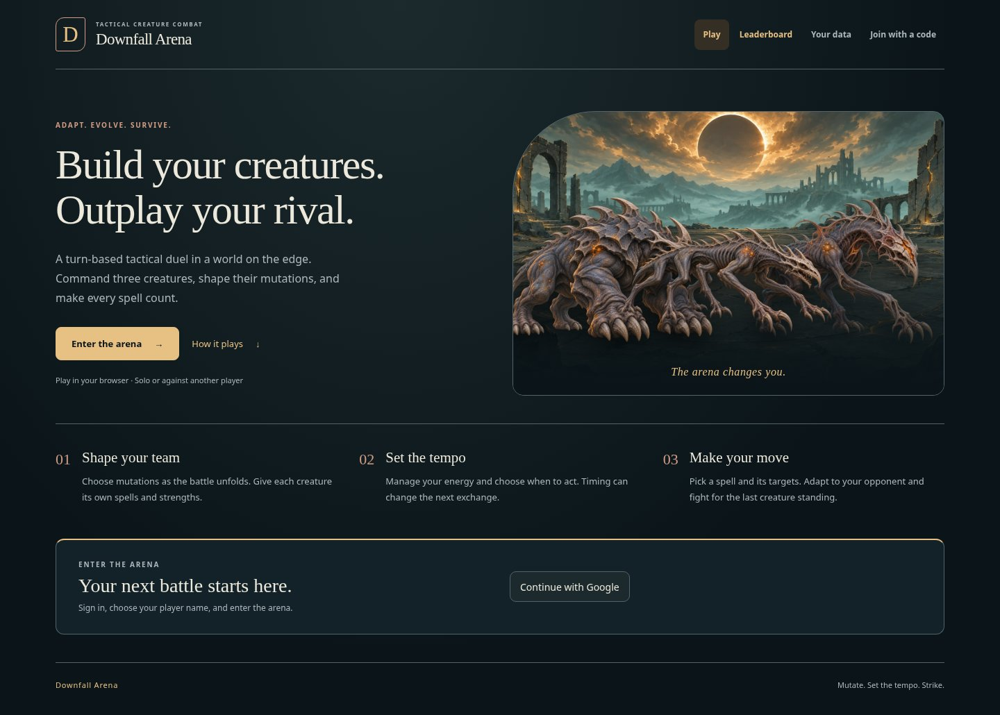
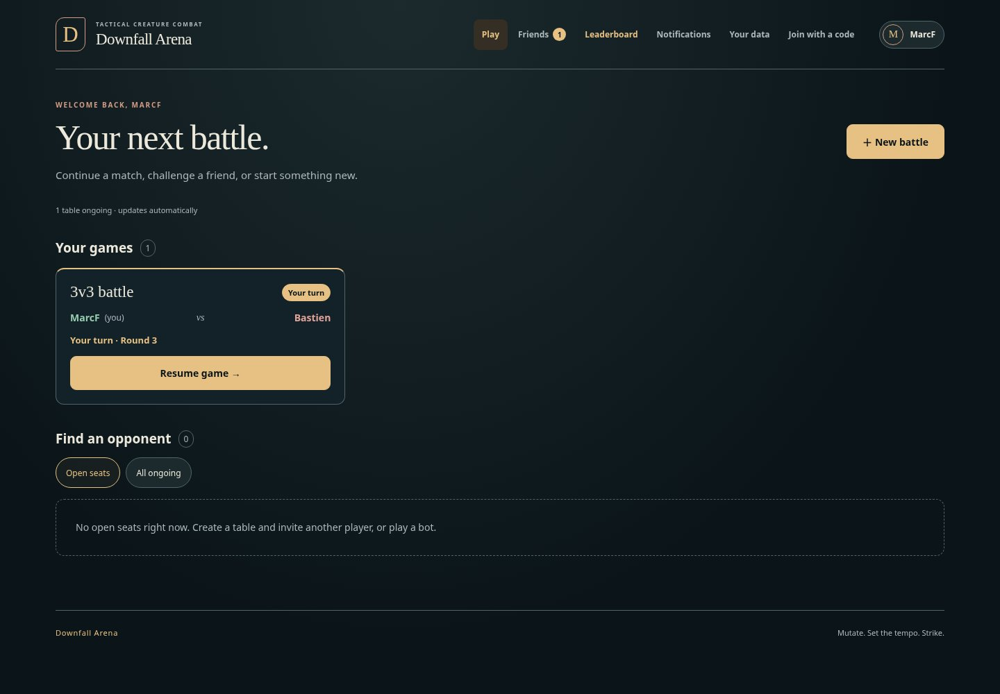
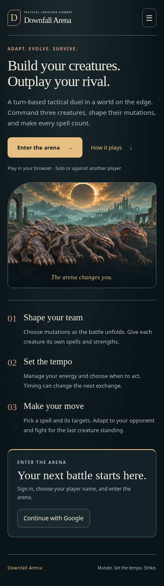
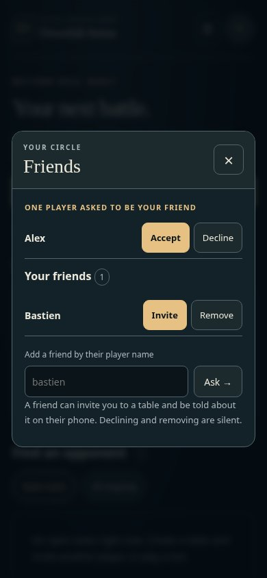

# Home navigation

The home page has two jobs: explain Downfall Arena to a visitor and bring a returning player to their next
battle. It uses the [official palette](../art/branding.md) and existing arena artwork. This changes the static
HTML/CSS/JavaScript presentation, with no new routes, framework or account rules.

## Page states

- **Signed out on an account host:** creature artwork, a short tactical-game introduction, three steps
  explaining mutations/tempo/spells, and the existing Google sign-in. No empty game lists, friend panel or
  device settings. The developer host still uses its typed-name sign-in.
- **Signed in:** a greeting, New battle, invitations, Your games, and Find an opponent. Account actions stay
  behind the player's avatar/name. Match cards retain resume, join, invitation and turn-state behaviours.
- **Accounts off:** the playable local lobby still resumes held seats and creates games. It does not show
  account-only menu entries or a sign-in invitation.

## Navigation

| Entry | Destination | Availability |
| --- | --- | --- |
| Play | Home/dashboard | Everyone |
| Friends | Dialog with requests, friend list, add/remove and Invite | Signed-in players |
| Leaderboard | Existing `/leaderboard` page | Account hosts |
| Notifications | Dialog with the existing device controls or an unavailable explanation | Signed-in players |
| Your data | Dialog explaining retained account, friendship and game data | Everyone |
| Join with a code | Dialog validating an eight-character invitation and following `/j/<code>` | Everyone |
| Admin | Existing `/admin` page | Existing operator check |
| Account avatar/name | Existing sign-out, sign-out-everywhere and delete actions | Signed-in players |

At 1100 CSS pixels and below, the navigation becomes a disclosure menu. Its button exposes `aria-expanded`
and `aria-controls`; Escape and an outside click dismiss it. It is ordinary navigation rather than an ARIA
application menu. Native dialogs handle focus containment and Escape, include an explicit close button,
and restore focus to the menu toggle on narrow screens or their desktop opener. Long modal content scrolls
inside a viewport-bounded body while the heading and close button remain visible.

Incoming friend requests appear as a count in the menu. Inviting from Friends closes that window and opens
the existing create dialog with the chosen friend selected. Merely opening Notifications never requests
browser permission; the existing explicit device action owns that request. Google sign-in still uses the
provider's rendered button, not a custom credential control.

## Refresh and account transitions

The manual Refresh button and browser-save/reconnect prose are removed. The lobby retains its ten-second
poll and also refreshes when the document becomes visible or the connection returns. A successful retry
clears the disconnected status even if the game list itself has not changed.

Account changes clear displayed private games, invitations and friends immediately. In-flight lobby results
carry a revision and cannot repaint the next account's dashboard; a queued refresh fetches its games. Initial
loading does not resume anonymous seats before the account mode is known. Seat adoption remains retryable
after a failed request. Existing invitation and `next` redirects are preserved.

## Verification and previews

`studio/browser/lobby-home.spec.js` exercises guest/member/local modes, friend acceptance and invitation,
modal focus and Escape, code validation, logout during an in-flight request, sign-in and automatic retry.
Layout checks include 320, 390, 900, 1101 and 1280 CSS-pixel widths and a 740 × 320 landscape viewport.
The existing table, admin and branding browser suites cover the shared styles and behaviours.

The screenshots use deterministic API fixtures; the Google button is stubbed in the browser test.

| Guest desktop | Player desktop |
| --- | --- |
|  |  |

| Guest phone | Friends phone |
| --- | --- |
|  |  |
