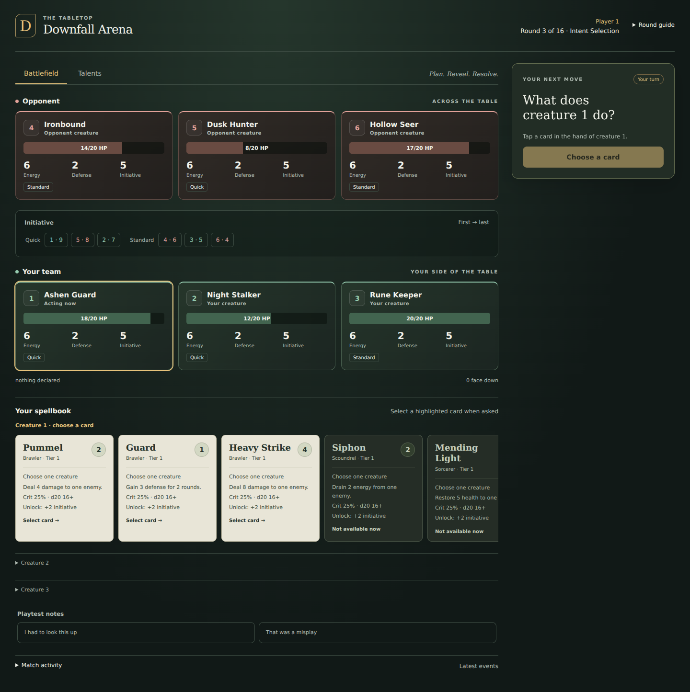
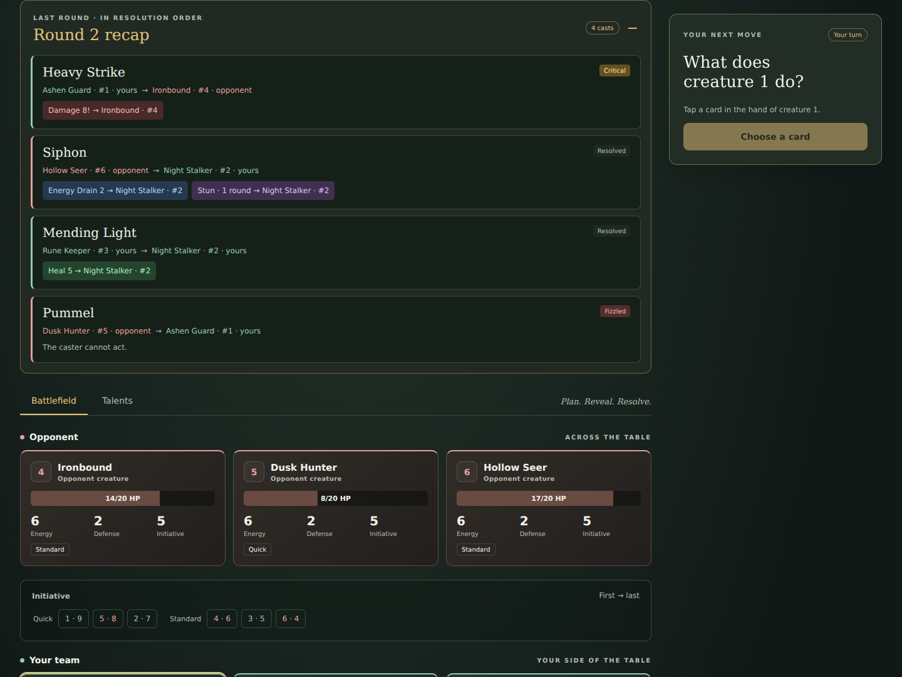

# Downfall Instinct table

A static tabletop client designed primarily for desktop, with responsive phone controls, served by the
existing .NET table host. No framework, build step, external fonts, or runtime dependencies. Game rules, legal options and card text still come from the host.

```bash
dotnet run --project src/DownfallArena.Cli -- table --p2 greedy
```

Open the seat link printed by the host. For two people sharing a screen, omit `--p2 greedy` and use the
hotseat link. See [the playtest specification](../docs/tabletop/playtest-app.md) for rules and recording.
With one seat in the browser (solo against a bot or each player on their own device), the game opens directly.
The “I am Player…” confirmation is reserved for browsers holding both seats on a shared device.

## Many tables, one host

The host plays as many tables as an evening needs (ADR 0081). Open `/admin?token=<the operator token the
console prints>` -- the admin panel -- to see them and to open more: choose who sits in each seat and the
format the table plays, read each seat's code to its player, and follow the pilot link to hand a seat over.
The format is each table's own, so a 1v1 and a 3v3 run side by side on one host; the chooser opens on the
host's own, which is what its `--rules` file and `--format` said, and the formats it offers come from the
host rather than from the page. The bots a seat is offered are the
ones `learning/seatable.json` puts forward, then every weights file under `learning/weights/`, read by the
host so a new search is offered without a page change. The panel also lists every recorded session the store
holds, whether or not this host still has its table, deletes one or several (a table still being played is
closed first) and exports one or several as a zip of run directories: unzipped under `runs/`, each is what
`train-clone`, `export-csv` and the viewer read. The list is filtered by state (finished, live, not
finished) and by who sat (human vs human, human vs bot, bots only), and paged twenty at a time, newest first;
the filters and the pages work on the listing the panel last read, so they never walk the store again. A
finished session, and a finished table, offers a **replay** beside its viewer link: `/play?replay=<id>` opens
the table page on that match's replay, action by action, with no seat at all. It reads
`GET /api/sessions/<id>/replay`, the operator's own route, which serves the match's outcome, each seat's last
board, the catalogue its table served and only the public events a replay reads, off the run the store holds,
whether or not this host still has the table; `&seat=player2` shows it from the other side. A table with a person in it waits for every person to
reach their seat before its first question, showing whoever is here the code that brings the other, and then
asks both players their package picks at the same time (ADR 0092), each player every pick of the
opportunity without waiting for the other's (ADR 0117), as it then asks their speeds and their intents (ADR 0111). On one screen the player holding it answers theirs before it is passed. A table page shows an **Admin** link in its header to the
operator's own browser (the panel keeps the token, or the platform's sign-in says so) and to nobody else.
`/lobby`, the panel's former address, redirects. A host that starts over a store rebuilds every table the
host before it left open, from the seed and the decisions it recorded (`decisions.jsonl`, `table.json`,
ADR 0091): the players' links and codes still reach their seats. `--lobby` starts the host with no table at all, which
is how it runs in its container, and `--platform-auth` makes the platform's sign-in the operator's door
instead of a printed token (ADR 0080). The hosted table runs exactly that, on Azure: see
[infra/README.md](../infra/README.md). From a shell:

```bash
curl -H "X-Seat-Token: <operator token>" -H "Content-Type: application/json" \
  -d '{"player1":"person","player2":"greedy","who":"mk"}' http://127.0.0.1:5099/api/tables
```

A table chooses spells at the slot (ADR 0110), the default since ADR 0112. It declares hidden intents instead
when the host was started with `--declaration hidden-intent`, when its `--rules` file says
`"combatDeclaration": "hidden-intent"`, or when the request that opens it says `"declaration": "hidden-intent"`
-- the admin panel's **Spells** chooser. At the slot nothing is declared: when a creature's slot comes up, its
player taps one of its castable cards, picks that spell's targets on the battlefield and confirms, and the
action resolves. Until the targets are confirmed, **Choose another spell** goes back to the cards (`slot.js`).

A starting host serves at once and rebuilds the tables an earlier host left open behind it (ADR 0091): the
container's platform restarts a host whose port does not answer within a minute, and replaying many records takes
longer. Until the rebuild is done, a seat whose table is not back yet, the lobby's seat routes and the join codes
answer `503` with `Retry-After`, never `403`, so a page waits for its seat rather than forgetting it.

A record whose replay is refused -- the content, the rules or the engine changed under it -- stays open for the
operator to close or delete (ADR 0115). When the record itself explains the refusal (a line that does not answer,
a match that ends before its record, boards that differ), its `table.json` notes the engine commit, content hash
and rule set it was refused under (`refusedUnder`). A host on that same basis leaves it as it is instead of
replaying it at every start; a host on another one tries it once more, and so does any host after a replay that
only ran out of time. A build with local changes or no commit marks nothing, so a fix in
progress is always tried. A replay that stops short of the checkpoint at a person's question is refused at once:
the ten seconds it may wait to catch up are for a bot still deciding, and nobody answers during a rebuild.

## Read-only presentation boundary

`presentation.js` is the shared seam between a seat controller and a renderer (ADR 0123, battle step A3).
The existing `/play` uses it; a future live Phaser adapter can import it without starting this page.

| Function | Input and responsibility |
| --- | --- |
| `decisionView(seat, latest, { asked, chosen, answered })` | Adapt an Action into spell/target screens only for the matching seat and asking; hide an already accepted Action until the next poll. Other question kinds pass through. |
| `presentedView(latest, replay, entries)` | Select the recorded before/after board and the public events up to that point. Clear the question and its options, but keep who is being asked: the spellbook and the Mutation Tree follow that creature while the frame is read. Keep the current view separate. Without a frame, retain current totals, as the replay's existing note explains. |
| `boardPresentation(board)` | Expose teams, round/phase and ordered timeline slots with position, side, rolls and cursor. Preserve the host's creature stats, conditions and order. |
| `activeTurn(board)` | Read the current slot only during Activation; never infer one during planning or cleanup. |

These functions perform no I/O and borrow their inputs as immutable snapshots; they do not clone or freeze
the host payload. They accept an **already seat-filtered** view, not a full match or another player's view,
and are not a security filter. Local choices are scoped to one controller/table and are discarded when that
controller is replaced. The controller still owns polling/SSE, feed cursors, seat selection, the hotseat
fence, choice resets, acknowledgement after actual display, and command submission. In `/play`, `rawViews`
remain the latest responses; `drawnViews` adapts questions, and `render` builds a separate historical display.
Neither renderer may post from a historical view or make animation completion advance the match.

## Player-facing words

The page shows the player's words for what the host serves under the domain's names: tempo **Instinct** and
**Precision** for the speeds `Quick` and `Standard`, the phases **Upkeep → Command → Combat → Aftermath** for
`StartOfRound`, `Planning`, `Combat` and `EndOfRound`, **mutation** for a Tier and **Stage N** for its level.
They are spelled once, in `terms.js`; the commands it sends and the ids it reads are unchanged. The list is
[docs/domain/player-terminology.md](../docs/domain/player-terminology.md).

## Preview

Earlier visual baseline, before the desktop workspace and floating atlas. These illustrative fixtures are
not recorded matches. Card text and creature names in the actual app come from the running host.





## Playing

- A completed round adds a compact recap button in the sticky top status bar. Open it to read the
  colour-coded casts, targets and outcomes in a floating panel; it never scrolls or pushes the battlefield.
  It remains available throughout the next round and after the match ends. Escape closes it.
- Each action resolves as its targets are confirmed (ADR 0083) and is shown live. The round bar carries one
  line of play-by-play: the action resolved last, the player's own included, or the opponent action being read.
  The opponent's actions are read one at a time before this seat's next question: the decision sheet is headed
  by that action (`Opponent's turn`, its own turn number, its caster and spell) with the seat's question named
  underneath as what comes next, shows the action (caster, targets, outcomes) with the battlefield as it stood
  right after it, and **OK** moves on;
  the question, its controls and its acknowledgement to the host wait until the last one is read, and so does
  the next phase's announcement: a round's last actions are often read once the host has started the next
  round, and the dock stays on the round being read (its combat) until the last OK, when the new round is
  announced, its upkeep ticks read on the board they moved, and the question asked. **Auto this
  round** OKs the rest of that round's opponent actions after a short pause each (and any still to come in
  it); the next round is read by hand again. **Skip all** reads past them at once; Enter or → is OK, Escape is
  Skip all. The seat's own actions are never held, and a reload only asks again for what resolved after the
  seat's own latest action. Once read, the round bar shows the last action and the recap keeps the completed
  sequence. The action resolved last marks its caster and targets on the battlefield with what it changed. A
  completed round is not replayed on its own; the recap's Replay action by action button opens a review
  in the decision column. Previous and Next traverse actual public results (including criticals and
  fizzles); Skip returns to the latest round or match results. The actor and targets are highlighted on the battlefield. Each action starts
  with the recorded Before state; Next applies its After state and shows actual outcomes and stat changes.
  Previous reverses either step. HP, energy, conditions, spellbooks and the timeline come from engine
  snapshots captured before cleanup and upkeep (ADR 0075). Skip restores the latest state including upkeep.
  Older recordings without snapshots explicitly label their battlefield as current totals.
  The next question and its asking acknowledgement wait until the review closes; replay controls send
  no decisions. Arrow keys step backward/forward and Escape skips.
- A finished match's result offers **Replay the match action by action**, which is the same review over every
  round: the page keeps only the last two rounds' events, so it asks the host for the seat's feed from its start,
  once. Each round reads in the order it happened: its upkeep (the round's energy and every tick), the packages
  its Evolution revealed, then its casts. Upkeep and purchases are one step each, on the battlefield the round's
  combat began on, which is the only board a seat's feed lets them borrow. Cleanup is not replayed. A selector
  jumps to the first step of any round. A finished game opened from the lobby's **View game** lands on the same
  result, with the same replay.
- The sticky top bar leads with round, current phase and the acting position/creature from the host timeline;
  on a phone the acting creature is the outlined chip in its battlefield bar instead.
  The decision repeats the phase and turn position above the creature/spell title; targeting starts with one
  short instruction and keeps confirmation help collapsed. Round flow, upkeep, announcements and recap are
  on-demand references in this same bar. Speeds reveal together;
  opposing spell choices reveal only with confirmed targets. The guide displays this distinction explicitly.
- The opponent, initiative order, your team and your spellbook keep the same reading order on every screen.
- Desktop keeps the battlefield beside a compact planning desk with the acting spellbook. The board stays
  visible while the page scrolls through longer spell lists; neither board nor hand has a clipped inner
  scrolling pane. Cards wrap into two columns and the active creature appears first.
- Below desktop width the battlefield is not a section at the bottom of the page. The round bar carries it
  at a glance, a chip per creature (number, health, energy, defense when it has some, a stun ring; the creature acting now outlined,
  whichever seat is deciding), and a
  Battlefield button that opens the whole battlefield over the page, under the bar; a second tap (or Escape)
  closes it where the player left off, and a handover closes it. A legal target is picked from its chip, so
  a spell aimed at an ally never sends the player past the opponent to find one; any other chip opens the
  battlefield at that creature, and the battlefield opened while a target is asked for starts at the first
  creature the spell may take. A picked chip says that a second tap casts, as its row does. With the
  phone targeting view active, rows containing legal targets grow from 39 to at least 72 px high, with
  8 px gaps and larger creature numbers, health and stats. Rows without legal targets stay compact, and
  every row returns to its normal size after targeting. The target preview uses a shorter estimate note.
  With the battlefield shut, arrows walk the legal chips and number keys pick as on a laptop; a chip that opens the
  battlefield hands it the focus, and closing it hands the focus back to its button. In a resolution replay
  the chips mark the caster and its targets and, once the action is applied, what it did to health. The bar
  never widens the page: a long phase name is cut short, and on the narrowest phones a chip showing a health
  change leaves its energy out.
- Phones keep scrolling short and never sideways: the acting creature's spellbook uses two compact columns,
  grouped by the card types the host supplies. **Full details** expands its cards into one column; speed's
  two-column reference reveals each spell's effects on tap. Selecting a spell keeps the cards and the fixed
  decision the same height, so the second tap that commits it lands where the first did. Packages are two-line rows, the
  opened battlefield prints each creature on a few lines with its stats as symbols (ϟ energy, ◇ defense,
  ↟ current initiative), and the turn order wraps. The mini battlefield shows health, energy, defense when
  present and current initiative on each creature. Round flow and the tab row are left to the Round guide and the
  spellbook's Mutation Tree link, and the turn in the round bar to the decision heading and the acting chip.
- Gold identifies the acting creature, selected card or target, and the next action. Team names and text
  labels also identify the sides and selection state, so colour is never the only signal.
- Evolution presents one creature's available packages at a time. Each pick buys all of a package's spells
  and its initiative bonus. The team shares two picks on rounds 1, 3, 5, etc. by default, capped by eligible
  living creatures, with at most one package per creature per opportunity (ADR 0066). Both the atlas and
  decision panel show effective remaining and spent picks; switching creature never resets them. The host
  supplies the next evolution round, displayed in the phase guide between opportunities.
- Once speeds are revealed the round bar gains **Turn order**: each side's speeds (the opponent's first) and
  every slot in play order with its initiative and any d20 roll, read off the host's timeline. Below laptop
  width it opens by itself once a round, when the timeline first exists (after a tie order question rather than
  over its buttons), and closes itself after nine seconds or on a tap anywhere on it; a laptop shows the same
  order beside the battlefield, so there it opens on request. Muting the phase pop-ups does not silence it.
  While a spell is chosen, the decision heading and the spellbook rows say where each creature acts (`Acts 2 of 6 · Quick`), since the order is set before intents.
- A tempo is chosen for each creature from its own tab (`Creature 1 · Instinct`) and nothing is sent until
  **Confirm tempos**, so any choice can be changed until then. Confirm sends them the way the host asks for them,
  one creature at a time; a refused one is shown and Confirm can be pressed again.
- **♪** in the masthead, beside the Round guide, holds the two optional settings, quiet UI sounds and haptic
  feedback, both off by default and kept on the device; it is lit while either is on.
- A phone held sideways (landscape, at most 520px tall) puts the battlefield and the desk side by side: the
  round bar and its chips head a fixed left column whose board scrolls on its own, and the decision and
  spellbook form one continuous scrolling panel on the right, without a height cap or nested lists. Mutation
  choices use dark cards with family accents and readable secondary text; they wrap to two columns when
  space permits. The Battlefield button is not drawn there: the board is always in view. Safe-area padding
  keeps controls clear of the phone’s cutout and gesture area.
- Speed opens the acting creature's spellbook as a compact reference: name, energy cost and positive
  Standard critical chance, with effects available by expanding a spell. Zero critical stats are omitted
  throughout the spell cards. On phones, the masthead shows the seat and Round guide; round and phase stay
  in the sticky bar. The expanded guide overlays that bar. Each new Speed or Intent question
  keeps the battlefield and planning desk visible together on desktop; smaller screens guide to the
  active decision. Later polls and local selection
  preserve deliberate scrolling. Other hands remain expandable.
- Tap a spell to select it, then tap it again or use the fixed Declare button; the rows do not move between
  the two taps, and choosing a card also closes a phase announcement that would cover that button on a phone.
  With a keyboard, Enter or Space on the chosen card declares it, and the arrow keys reach the Declare button. Tap a selected target again to cast on the entire
  selected group once the host's minimum is met. Remove buttons let you correct a target set; single-target
  spells also let you switch by tapping another creature. Declare and Cast buttons remain available.
  Enter or Space works too; holding a key or tapping while a request is pending never submits again.
- The Mutation Tree opens over the battlefield as a non-modal window: drag its title, resize its corner,
  maximize, reset or close it. Arrow keys on the title move it as well. Phones use a full-screen panel.
  Its sticky toolbar keeps the creature, round, Evolution pick number and remaining picks visible.
  Down from the last package or spell choice reaches the explorer; Enter opens it and Up returns to the choices.
- The Mutation Tree draws the mutation prerequisite graph in three rows (stages 1–3); a phone reads it top to bottom
  instead, one family per block with each upgrade beside the package it grows from, and choosing a package
  brings its spells up with a way back to the list. Names and edges come from
  catalogue packages, not the retired per-spell gates. Select a package to read its prerequisites by name,
  initiative bonus and all its spell faces side by side. Ownership comes from `acquiredTiers`, independently
  of known spells; only the host's `availableTiers` can enable a purchase.
- Every mutation card, Mutation Tree node and inspector wears the mutation's two or three identity tags as chips
  (`tags` on the catalogue package, `docs/domain/package-identity-tags.md`), so a pick can be scanned before
  its spells are read. A catalogue built without them shows none.
- The authored first-level families use coherent cool, leaf and ember palettes, with shades inherited by
  specializations. These accents follow every card into the spellbook and unlock picker.
- Acquire legal mutations directly from the Mutation Tree. A creature that acquired one this opportunity remains
  inspectable but cannot acquire again. New Speed, TieOrder, Intent and Target questions close the atlas to expose the board.
- The initiative strip retains d20 rolls and rerolls. TieOrder has its own phase reminder and guarded
  keyboard/pointer controls to order your creatures within your side's assigned places before declarations.
- Every battlefield creature receives a circular turn number once the host has built the timeline. The
  number follows the full server order, including ties; the slot being activated is highlighted.
  Order numbers run from turquoise to violet; Quick tags are gold and Standard tags blue. Energy, defense
  and initiative have separate colours and retain text labels. The order strip spells out creature identity
  and initiative separately. Creature numbers replace repeated definition names in the play surface.
- Spell faces use restrained paper tints with labelled effect and critical badges derived by the catalogue
  projection. The client does not infer effect categories from spell names or parse effect text. The critical
  badge and reminder state the maintainer-confirmed rule: Instinct cannot crit; Precision can, multiplying only
  direct damage/healing on targets. This rule is now enforced by the engine on main; the UI does not alter combat resolution.
- The energy cost has an icon and a visible label. Spell stats show critical chance, its Precision-only
  reminder and host-provided d20 threshold. Initiative and acquisition requirements appear once per mutation,
  never as obsolete spell stats. Targeting and effect cues retain their visual markers.
- Phase changes show a non-blocking announcement below the top bar for 6 seconds. It does
  not move focus, delay a decision or replay on selection/poll redraws. Reduced-motion preferences disable
  the entrance animation, and with them every transition and animation of the page: the motion tokens in
  `table.css` (`--motion-fast`, `--motion-normal`, ... and the `--motion-enter`/`exit`/`standard` easings),
  which effects use instead of their own timings, all fall to zero; hotseat handovers hide and cancel the departing seat's announcement.
  Before the match begins, the dock says it is waiting for players; upkeep and phase announcements wait
  for the host to clear `waiting`, even if round one's board and upkeep events are already prepared.
  New rounds get a larger, gold-accented “Round N begins” announcement. When there are ongoing health ticks,
  Next advances through the applied healing, then the applied damage, then the remaining conditions, one
  step a kind: each step is one row a creature -- its number in its side's colour, then symbol chips (`+2 ♥`,
  `−1 ♥`, `◇ −2 · 2r`) with the host's words on the chip's title. The ticks being read are marked on their
  creatures' chips in the mini battlefield, beside the health bar they moved; the energy allowance is context
  on the first step, not a step per creature. The notice waits until Done,
  Skip ▸▸ or Close, and a replay from Announcements starts again at the first tick. Loading an existing round does not
  pretend that a new round just started.
  Hovering or focusing pauses expiry; Keep open pins the notice and Close dismisses it. Announcements holds
  the last twelve notices per seat for this page session. Replaying one stays open and is marked as an earlier
  announcement; it does not change the current phase, question or selection. The top bar remains current.
  **Mute phase pop-ups** (on the notice, or at the top of Announcements) stops the phase explanations for the
  rest of the match; changes are still listed under Announcements and earlier ones still open from there. The
  upkeep's ticks are not muted: like the turn order, they are what happened to the board, not an explanation. While
  muted, the same toggle at the top of Announcements turns them back on. The mute is kept per match (by its
  seat tokens) across a reload.
- The dock's **Match** tool holds the one thing a player can do to the match itself: **Concede the match…**,
  then **Concede** to confirm or **Keep playing** (ADR 0087). The seat on screen gives up -- in hotseat, whoever
  holds the device -- and the opponent wins on the spot; the end screen and the masthead then say who won and
  why (`You conceded · Player 2 wins.`, `You win · the last team standing.`, a draw), for every way a match
  ends. A seat a bot plays, a finished match and the practice table offer no concession. A recorded session
  writes it as a `Concession` note; the trace's `MatchEnded` carries the reason.
- Automatic upkeep remains readable through the dock's Upkeep control for the current round. It shows the
  configured energy allowance and the actual applied ongoing energy, healing and damage ticks as one row a
  creature of symbol chips (♥ health, ϟ energy; the legend is on the panel), in engine order, followed by the
  active conditions as chips (◇ defense, ↟ initiative, ⊘ stun, `2r` rounds left, `∞` permanent) with their
  full words on each chip's title. The glyph and the sign of each kind come from the catalogue's `effects`
  (`EffectCue`): the page names no effect, and a kind the host serves no mark for keeps its word.
  These public events are retained separately from the short
  activity log. Escape closes the panel. A new round announces upkeep even when polling skipped that phase;
  missing events are never reconstructed from board deltas or guessed from conditions.
- On phones, the evolution budget and creature picker remain in view while the offered packages scroll within
  the decision. Speed options and the spell declaration remain in view while only the spellbook scrolls. The
  battlefield shows each opponent creature's public acquired packages beside its conditions and confirmed
  spell, with no inference from its known spells. After an observed evolution opportunity, one announcement
  recaps both teams' newly acquired packages; an initial load does not invent a purchase. A round announcement
  steps through actual ongoing ticks and conditions still active on the current board, while Upkeep retains the
  full tick list. The round bar and board already show resolved actions, so the duplicate decision box is gone.
- Opponent spellbooks expand below their team and update from public known spells as unlocks appear.
  These reference cards never select an action and never expose the opponent's face-down choice.
- Each spell becomes public together with its confirmed targets, in timeline order (ADR 0070).
  The first creature sees no unrevealed enemy choices; the fifth can read the first four confirmed actions.
  Local target selections remain private until confirmation. Confirmed spells, targets and resolution status
  update on the battlefield. At the next round, the previous public action is explicitly
  labelled “Last round” until a new one is revealed; it is recovered from the seat's public feed on reload.
- Your creatures display their current spell directly below their stats: draft choices say Not declared,
  accepted private intents say Not revealed / No targets chosen yet, and local target selections say not
  confirmed. Public confirmation replaces that private summary with the real target names and reveal status.
  Opponent cards still consult confirmed public actions only. The duplicate face-down text strip and
  expandable revealed-action list below the board have been removed.
- Round guide contains the host's round order and rule stamp. Match activity and playtest notes stay below
  the spellbook. The opaque handover screen remains the hotseat privacy boundary.

An unchanged poll leaves the DOM alone. Local selection does not wait for another network round trip,
scroll positions and keyboard focus survive a redraw, and a refusal stays visible until a successful
submission or a new question. Only one poll runs at a time, and an old response cannot redraw a board after
a decision has been sent.

## Keyboard

| Key | Action |
| --- | --- |
| 1 / 2 during Speed | Choose Quick / Standard for the creature on screen (Confirm sends every tempo) |
| 1–9 during Intent or Target | Select the numbered card or legal target; repeated numbers do not commit |
| Enter | Confirm the selected intent or valid target set; activate a focused button normally |
| 1–9 during Evolution or in the atlas | Choose the creature to evolve or inspect |
| T | Open / close the Mutation Tree |
| Enter / → while an opponent action is read | OK: read the next one, or reach the question |
| Escape while an opponent action is read | Skip all the opponent actions left |
| Escape | Close the battlefield or the atlas; otherwise clear the pending card/target selection |
| ? | Show / hide contextual shortcut help |
| Tab, Enter / Space | Navigate and activate controls, including class nodes and unlocks |
| ← / → | Switch Evolution creatures, or focus the next speed, spell or legal target |
| ↓ from an Evolution creature | Focus its first offered spell |
| ↑ / ↓ within choices | Move to the closest choice in the preceding / following visual row; ↑ from the first Evolution row returns to the creature picker |
| Enter on a spell / target | First selects, then confirms the existing selection; Evolution packages use their normal single activation |
| Arrow keys on the atlas title | Move the desktop window |

Shortcuts ignore text fields, selectors, contenteditable areas, modifier chords, key repeats, in-flight
requests and the hotseat fence. Card and target numbers match the host's option order. Arrows follow the visible layout; they never cast or
declare on their own and do not change the engine's acting creature.

## Verification

```bash
node --test studio/*.test.js table/*.test.js
dotnet build
dotnet test
dotnet format --verify-no-changes
```

`table.test.js` runs the shipped renderer in a minimal DOM double using Node's standard library. It covers
stable polling, keyboard selection, asking identity, target bounds, creature-specific unlock lists, the
handover fence, visible refusals, request failures, in-flight poll ordering, decision scrolling, second-tap
confirmation, public opponent books, live public actions, opponent actions read one at a time (OK, auto, skip), muted pop-ups, the turn-order pop-up, talent filters, keyboard guards and server-derived
turn numbers. Hierarchy and palette tests cover reordered nodes, tree-scoped parents and descendant shades. The feed tests also cover
completed-round recap formatting, event round identity, applied outcomes, failed casts and independent
two-round retention. It complements the existing
projection and transport tests; it does not replace a visual browser check.

For a browser check, exercise Evolution, Speed, Intent and Target, pass the device between seats, inspect
Talents and expand another creature's hand. Check a narrow phone and a desktop, with a scrolled hand and a
slow connection. Verify that only the chosen action is submitted, unavailable cards remain readable, and
that the handover screen covers the entire board.
## Decision guidance and practice

Choosing a spell shows the engine's energy cost, energy left after paying it, turn
position and critical chance on the card itself (on a phone's compact cards, under
**Full details**). The plain/critical effects against the current targets appear at the
Target step, before the cast is confirmed: during Intent a growing preview moved the
cards under the player's finger, so it stays out of the fixed decision. Choosing speed shows the Quick/Standard trade and each spell's critical
chance. A card the creature cannot pay for yet stays dimmed and keeps the engine's reason, but can still be
selected as a plan: it says how much energy it is short of, the Declare button says it may fizzle, and it
fizzles at its slot unless an ally gives it the energy first (ADR 0107). Caster effects appear
once, separately from target effects.

Candidates a spell would treat alike share one preview line (`Creatures 1, 2, 3 · Heal 4`).

The preview is explicitly conditional: earlier actions can change the board, rolls
are unknown, and computed effects still go through execution caps and condition
stacking. It never reads hidden enemy choices or consumes the match's random stream.
The Before/After replay remains the record of what actually happened (ADR 0079).

Start a separate practice table with the standard built catalogue:

```bash
dotnet run --project tools/DownfallArena.DataBuilder -- data data/dst
dotnet run --project src/DownfallArena.Cli -- table --practice
```

In Visual Studio, open `DownfallArena.slnx`, set `DownfallArena.Cli` as the startup
project, select the `table (practice scenarios)` launch profile, and press F5. If
the compiled schema is missing, run the DataBuilder command above once first.

Open the practice link printed by the host. Select a scenario and press **Start
scenario**; **Restart this scenario** returns to the same question with the same
seed. The page goes straight to your decision; simulated setup rounds do not open a
replay. `--bind <your LAN IPv4 address>` and `--port N` also work for a phone.

| Scenario | Starting point | Try |
| --- | --- | --- |
| Choose your target | Round 1, Shock targets | Compare targets and the energy left after cost |
| Build a multiclass creature | Round 3, evolution | Add a different level-1 package to Brute or take a level-2 upgrade |
| Interrupt an action | Round 5, Paralyzing Barb targets | Stun before an enemy acts; follow skipped actions and later immunity |
| Read a layered resolution | Round 5, Void Pulse targets | Follow multiple targets, bleed and Deranged Charge's caster effect |
| At the slot: answer an armor | Round 3, your Stormborn's action | The enemy Ironhide has cast Carapace: strike through it or turn to another enemy |
| At the slot: an ally's Overdrive | Round 3, your Frenzied's action | Your Blighted's Overdrive has just made Fury payable |
| At the slot: drained before your turn | Round 3, your Frenzied's action | The enemy Oppressor's Claim has drained an energy: Fury is out of reach |
| At the slot: stunned before your turn | Round 3, your next creature's action | The enemy Oppressor's Crash stunned your first creature, whose slot is skipped |
| At the slot: three allies in a row | Round 5, your three creatures act first | Open with Contagion, follow up, finish |

The five "At the slot" scenarios play a rule set that chooses each spell at its creature's slot (ADR 0110):
nothing is declared, and the person picks a card then its targets when the creature's turn comes. They set up
the boards the free-activation playtest asks about (`docs/tabletop/free-activation-playtest.md`); the rule line
says "spells chosen at the slot".

Practice uses seed 17 and a ten-round cap, plays its setup through the actual engine,
and continues normally after handing player 1 to you. It writes no playtest files or
training episodes. A reset creates a new match and invalidates its previous seat
token. It cannot reset an ordinary table. Custom content that cannot satisfy the
recipe fails with an explanation; rebuild the standard catalogue to use these recipes.

Browser checks against the live engine, on phone and desktop:

```bash
dotnet build src/DownfallArena.Cli
cd studio/browser
npm ci --ignore-scripts
node node_modules/playwright/cli.js install chromium
node node_modules/playwright/cli.js test --config table.config.js
```

## Player lobby

Open `/` or `/lobby` to resume this browser's games, join an explicitly open place, create an online,
solo or shared-device table, or enter a seat code. `/play` is the table itself. Return to **Tables** to
switch games without leaving a seat. **Match → Leave table** explicitly frees the team for a replacement
and invalidates the old token and code; closing the page keeps them. Taking an open place from the lobby
hands it over under a fresh token and code, so an invitation already sent for it stops working. Open tables
and place availability survive redeployment through the same recorded store as the decision journal, and a
table that never began is closed after twenty hours nobody asked anything of it (ADR 0115).

**Your turn**, above Your games, gathers every game waiting for the player, against players and bots alike, the
one whose time to answer runs out soonest first, and **Play next** opens that one. The games stay in their groups
below too, where the ones waiting for the player also come first, in the same order.

## Signing in (ADR 0122)

`table --accounts google --google-client-id <id>` (or `DOWNFALL_GOOGLE_CLIENT_ID`) lets players sign in on the
home page with Google; `--accounts dev` signs in by a typed name instead, on a loopback host only. The page shows
Google's own button, then asks a first-time player for a unique name (3 to 20 letters, digits, `_` or `-`; bot
names reserved), and puts the account in the masthead with *Sign out* and *Sign out everywhere*. The host checks
Google's ID token itself and keeps its own `HttpOnly` session cookie for thirty days. Accounts are kept beside the
recordings: `runs/accounts/`, or the `accounts` container next to the recordings' one. Nothing else is kept: no
email, no real name, no picture. The routes are `/api/account/*`, and `/api/me` says `accounts`, `googleClientId`
and `account`.

With accounts on, playing needs a sign-in, and a seat belongs to the account that took it: opening a table, taking
an open place and accepting an invitation answer `401` to nobody, and a seat's token alone is refused (`401`
signed out, `403` for another account). A seat that belongs to nobody yet, from a link or a code handed out before,
becomes the account's that first reaches it signed in. **Your games** is the host's list (`GET /api/lobby/mine`),
the same on every device; the seats a browser saved before signing in are handed over once
(`POST /api/lobby/adopt`). Cards name each side: a person by their player name, a bot by its label, an open place
as *Open seat*. A seat link opened signed out goes to `/lobby?next=...` and comes back after the sign-in. The game page's masthead says the same under the seat's name ("You: MarkF · against Greedy (bot)"), asked of
the host when the page starts and again a few seconds after the table changes (ADR 0164), so an opponent who takes the open place shows up by name. A card of an unfinished game says whose turn it is: *Your turn* in gold when one of this
browser's seats is being asked, otherwise the name of the player the match is waiting on, or both players.

The account menu's *Delete account…* (`DELETE /api/account {"username":"<their name>"}`) deletes the account once
its player types their name: its seats in unfinished games are offered to other players, its name and sign-in are
freed, and every session of it stops working. The lobby's *What we keep* panel says what an account holds.

A recorded match with an account in it leaves a result for a future leaderboard when it ends (stage 5 of the
plan): `results/<yyyy-MM>/<matchId>.json` beside the accounts, with each seat's account id or bot, the winner, the
rounds and whether it is *ranked* (two seats, two different accounts). No name is written there.

`/leaderboard` is the ladder (ADR 0124), linked from the lobby when players sign in: every account with a ranked
game, by Glicko-2 rating with its ± and its record, provisional players (± above 110) after the others, and for
whoever is signed in their place and their record against each bot. `GET /api/leaderboard` answers anybody; the
ladder is recomputed from the results every half minute at most.

## "Your turn" on a phone

A page offers **Notify me when it's my turn** once the host has push keys (ADR 0118): the phone is then told
when the match asks that seat something and nobody is looking at the page, screen off or browser closed
included, and a tap on the notice opens the game. A page in front of somebody gets no notice, the battle view (`/battle`)
included: the host still sends one when the battle view's controls were not opened within the grace (ADR 0126), and the
worker keeps it quiet while a battle view at that table is visible and focused, so an installed app being played is not told what it
shows; a tap on a notice brings a battle view already open at that table to the front and leaves it there. A page hidden
behind another app or a locked screen counts as nobody looking, even while it still runs. The notice says
"your turn" and the round, nothing else. On an iPhone the button says to add the table to the home screen
first. Every seat page makes the offer once, in a bar at the bottom of the screen, and its answer is remembered
by the browser; the button stays in the Match panel and in the waiting room. The second player to arrive never
waits in a room, so the bar is where they are asked. Where no notice can reach, the Match panel says why instead of
showing nothing: a browser built into a chat or social app (**This browser cannot notify you**: open the table in
Chrome, Firefox or Safari), notifications blocked for the site, or plain http on a network address. A device holding
both seats of the table is hotseat and is told nothing: the other player is whoever holds it (ADR 0120), and its
Match panel says **No notices with both seats here**. The host's log says which seat was notified of which asking, and why a notice could not be sent.
Once subscribed, **Send a test notification** (Match panel) shows two notices at once: one the page shows
itself, through the worker and no push service, and one the host sends through the push service, with what
the service answered under the button. Both appearing is a phone that works; only the page's is a push that
does not reach this browser; neither is a browser not showing notifications for this site.

With accounts on as well (ADR 0122), a signed-in player's lobby offers **Notify me on this device**
(`docs/tabletop/friends-plan.md`, stage 1): the browser's push subscription becomes one of the account's
**devices**, kept beside the accounts (`devices/<accountId>.json`, five at most, the oldest replaced), where a
notice that is not about a seat will reach the player: a friend's request, an invitation, the end of a match. A
seat's "your turn" still goes to the seat's browser as above; the same subscription is registered for both, and
the host tells each endpoint once. **Stop notifying this device** forgets the device and leaves the subscription
to the seats; **Send a test** sends one notice through the push service to this device. *Sign out everywhere* and
deleting the account forget every device. The routes are `PUT`/`DELETE /api/account/push` and
`POST /api/account/push/test`, all signed in; a host without push keys answers 404 and the lobby shows no panel.
The worker shows a notice unless a window on the page it opens is in front of somebody: a lobby notice over a
game, a "your turn" over the lobby, neither over its own page; every open page is told a notice arrived, so a lobby
reads its lists again at once.

## Loading and offline (ADR 0166)

The host reads each file once, sends it compressed (Brotli or gzip) with an `ETag`, and answers 304 when the
browser's copy is current. Pages, scripts, styles and `sw.js` are revalidated on every load, so a deploy reaches
every page at its next load; pictures and the font are kept a day. Every page with the navigation registers the
service worker, which serves nothing from a cache but `offline.html`, shown when a page cannot be loaded at all;
it reloads by itself when the network is back.

## Friends

Signed in, the lobby's **Friends** panel (ADR 0129, `docs/tabletop/friends-plan.md` stage 2) lists your friends, the
players who asked to be your friend (*Accept*, *Decline*), and the ones you asked who have not answered (*Withdraw*),
and asks a player by their exact player name, the one on their cards: there is no directory and no search. A
friendship is mutual: a request until the other accepts, and asking somebody who already asked you accepts.
Declining, withdrawing and removing a friend are silent to the other side; a declined player may ask again. A player
keeps at most a hundred friends and a hundred pending requests. On a host with push keys, the other player's devices
are told of a request (*MarkF wants to be your friend*) and of an acceptance; a tap opens the lobby. Friendships are
kept beside the accounts (`friends/<accountId>.json`, both sides written) and go with the account. The routes, all
signed in: `GET /api/friends`, `POST /api/friends/requests {"username":"..."}`, `POST /api/friends/requests/<id>/accept`,
`DELETE /api/friends/requests/<id>`, `DELETE /api/friends/<id>`.

## Inviting a friend

*Invite* beside a friend, or *A friend · seat kept for them* in the create dialog, opens a table whose second seat
is **kept for that account** (ADR 0129, stage 3): it is not an open place, has no code and no link, and only that
friend, signed in, accepts it from the **Invitations** section of their lobby (*Accept & play*, *Decline*). Their
devices are told (*MarkF invites you to a 2v2 battle*; a tap opens the lobby), the inviter waits at the table
(*Waiting for your friend to accept…*), and is told when the friend accepts (a tap opens the table; the first
"your turn" that follows is the match starting, ADR 0092) or declines. One invitation of a player's waits at a
time, for a day at most; removing the friend cancels it. The inviter's card says *Waiting for bastien…* with
*Cancel invitation*, or *bastien declined* with the three ways out: *Invite another friend*, *Open the seat to
everyone* (today's open place) and *Close the table*, which any player holding every taken seat of a table that has
not begun may do. A rebuilt table (ADR 0091) still waits for the friend. Cards name an invited seat by the friend
(`kind: "invited"`). The routes, all signed in: `POST /api/lobby/tables {"opponent":"friend","friend":"<accountId>"}`,
`POST /api/lobby/tables/<id>/accept`, `/decline`, `DELETE /api/lobby/tables/<id>/invitation`,
`POST /api/lobby/tables/<id>/invitation {"friend"}`, `POST /api/lobby/tables/<id>/open`, `DELETE /api/lobby/tables/<id>`;
`GET /api/lobby/mine` adds `invitations` and each own table's `invited`.

When a match ends, each seat's account is told how, against the other side by name (*Victory · You won against
bastien*, *Defeat · bastien won*, *A draw*); a bot's seat is told nothing, and one account holding both seats of a
shared device is told once, in the room's words. A player who leaves a begun match is announced to the other
seat's account (*bastien left the table*). The outcome card offers **Rematch**, which opens the lobby's create
dialog on the same opponent and format: the friend (or, if they are not a friend yet, a word to ask them first),
the bot, or the shared device. Deleting an account also offers the seats it kept for friends to everyone, as ADR
0122 offers its own, and frees the seats kept for it (stage 4 of the plan).

```bash
dotnet run --project src/DownfallArena.Cli -- push-keys > push-keys.json        # once; keep the file
dotnet run --project src/DownfallArena.Cli -- table --push-keys push-keys.json --p2 greedy
```

Only an https page or `localhost` can subscribe: a table reached over http on the LAN (`--bind`) shows no
button. On iOS the table has to be added to the home screen first (the page ships a manifest and an icon for
it). Changing the key pair unsubscribes every phone, which is why the file is kept. The hosted table takes
its pair from a repository secret (`infra/README.md`).

A seat's link and code carry an **invitation**, not the seat itself (ADR 0116). Opening one asks first: **Take
the place** accepts it, once, and the link and code then stop working for anyone else. A browser that already
plays the other seat of that table is offered **Back to** its own seat instead, so a player who opens the link
meant for their opponent does not take that seat by accident; playing both seats on that device is an explicit
second button. A player who lost the device holding a seat gets a **New invitation** from the admin panel,
which cuts that device off.

## Battle design laboratory

`/battle-lab` opens an isolated Phaser battlefield that fits the viewport in portrait and landscape.
It has provisional illustrated creatures, a fixed sample action with three target outcomes, animated
impact, keyboard/touch controls and inspection/settings overlays. It uses no seat or API. Reset, skip,
2× playback, optional sound and reduced motion are available. `/play` remains the actual game.

Build the local renderer before opening the lab or running host route tests:

```bash
npm --prefix battle ci --ignore-scripts
npm --prefix battle run build
```

Docker and CI build it automatically. See [build details](../battle/README.md) and the
[browser battle plan](../docs/tabletop/browser-battle-plan.md) for screenshots and the integration PR sequence.

## Battle view preview

`/battle` is an opt-in live view with combat controls, linked from **Match → Open battle view preview**.
It asks for a viewpoint before reading a private board and supports accepted saved or linked seats.
Inspection sends no commands or `shown`. Opening combat controls acknowledges the visible question;
spell and target choices require explicit confirmation. Action, hidden Intent and revealed Target use
`slot.js` builders shared with `/play`; the host remains the authority for options and resolution.

`battle-combat.js` owns drafts and request lifetimes, `battle-live.js` owns fenced polling/SSE, and the
separate `battle-build/live.js` bundle cannot import the lab sample. `battle-playback.js` queues confirmed
combat frames and deduplicates them by sequence. Damage, conditions and defeats follow the host's before/after
frames, including the last action before upkeep. Skip or opening combat controls settles to the current board;
playback never acknowledges or sends a decision. First reads, legacy frames and long catch-ups settle immediately.
[ADR 0127](../docs/adr/0127-play-confirmed-actions-in-the-live-arena.md) records that boundary. Mutations, tempos, ties and results are available in the battle view
([ADR 0128](../docs/adr/0128-complete-the-game-loop-in-the-arena.md)); invitation acceptance remains at `/play`.
The existing host still marks an accepted seat as arrived on authenticated reads. See [ADR 0125](../docs/adr/0125-read-one-authenticated-seat-in-the-live-arena.md),
[ADR 0126](../docs/adr/0126-answer-combat-questions-in-the-live-arena.md) and
[the build instructions](../battle/README.md).

The battle view's **History** drawer retains public events from the current and previous round, capped at 200.
Attacks expand into actual applied effects and recorded before/after changes; reading history preserves
command drafts and never sends a decision or `shown`. It is separate from animation playback, so skipping
an animation does not remove its result. `battle-history.js` normalizes/deduplicates public events and
`battle/src/history.ts` renders stable accessible details. AU3a adds recorded ordinary-energy gains,
including zero and before/after values, to new matches. Classic replay also separates recorded ordinary
energy from ongoing ticks; neither step adds a nominal catalogue allowance. AU3b presents a grouped receipt
once arrivals clear and at observed round transitions, after playback and before tips. `battle-upkeep.js`
shares recorded facts with round review and replay, retains zero gains/heals, and labels absent ordinary
energy as unknown. Inspection shows current durations separately. A bounded tab-local round marker prevents
repeat announcements after reconnect/reload, without persisting event facts. Filters and earlier
round loading remain later slices of the [UX parity plan](../docs/tabletop/battle-ux-parity-plan.md).

The battle view's **Help** dialog explains the current objective and the round flow, including the configured
spell declaration mode. First-use tips appear once per subject and can be muted; Help remains available.
`battle-guidance.js` derives text from the current seat/offer and authoritative next mutation round.
It does not acknowledge questions or send commands, and opening it preserves pending choices.
See [AU2 and its verification](../battle/README.md#au2-objectives-and-contextual-help).
